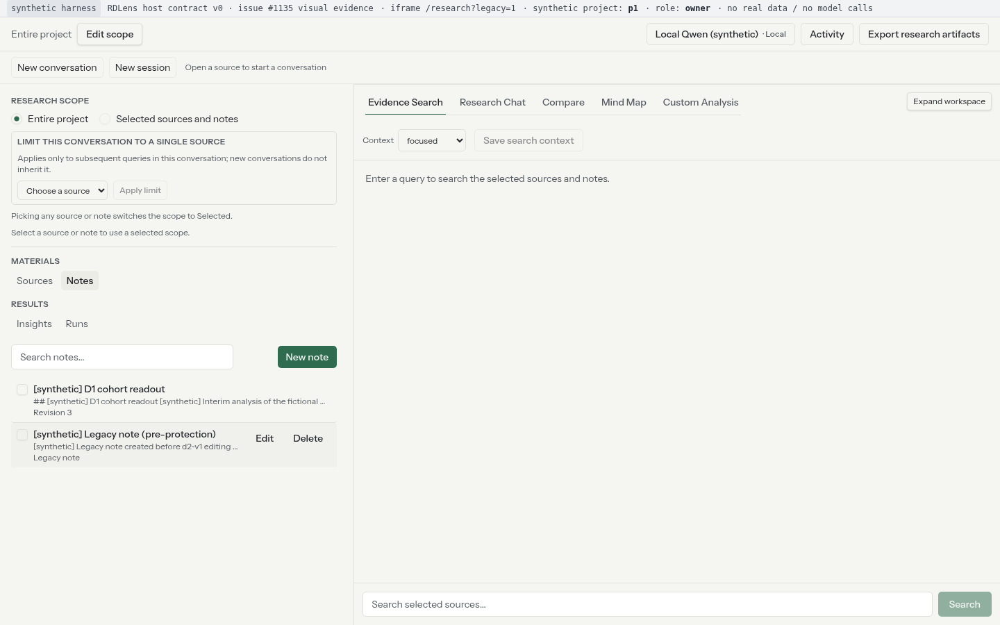
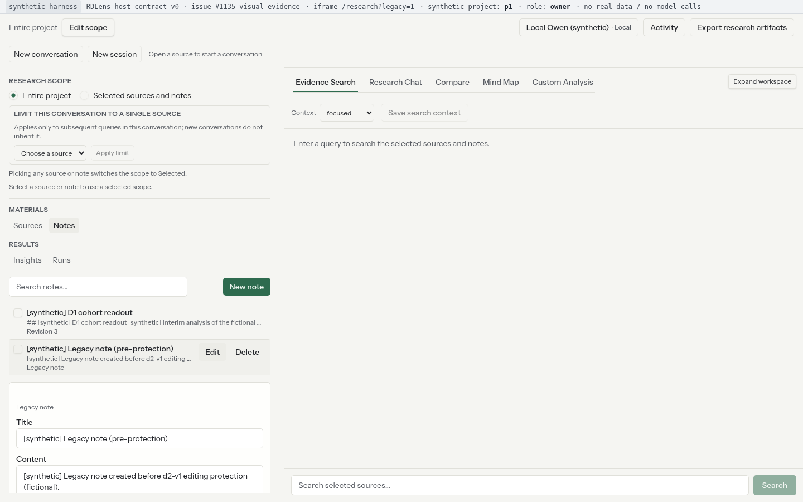
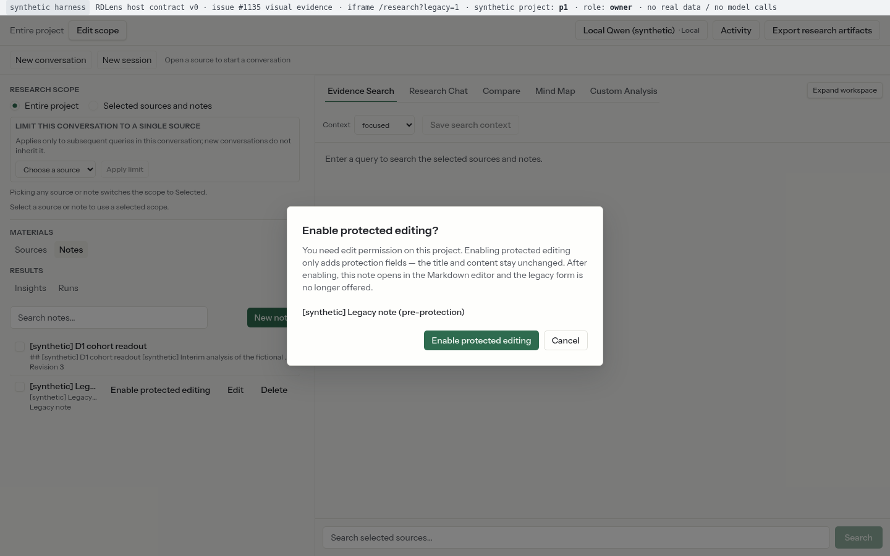
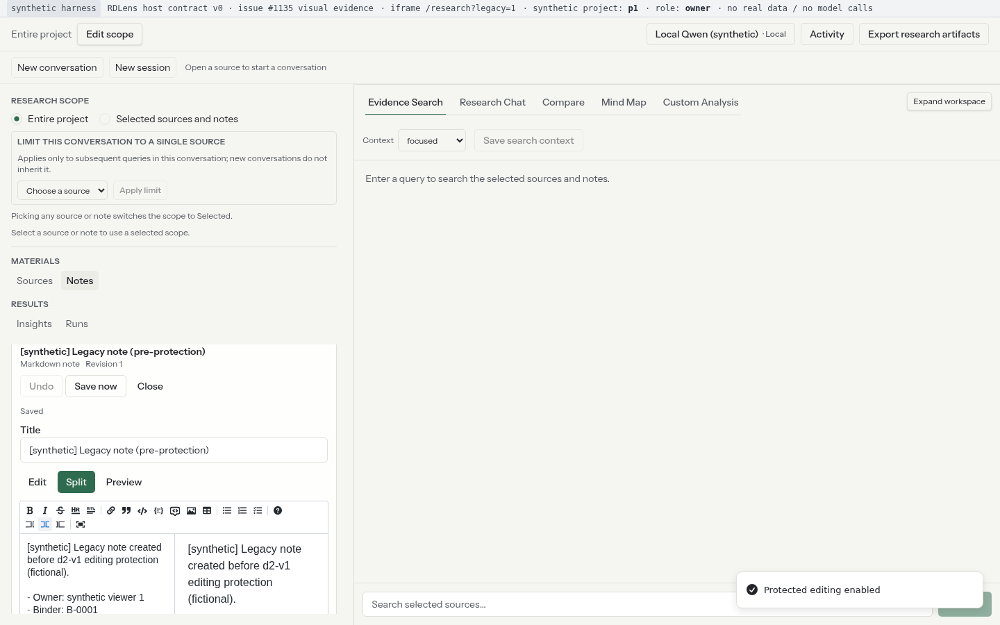
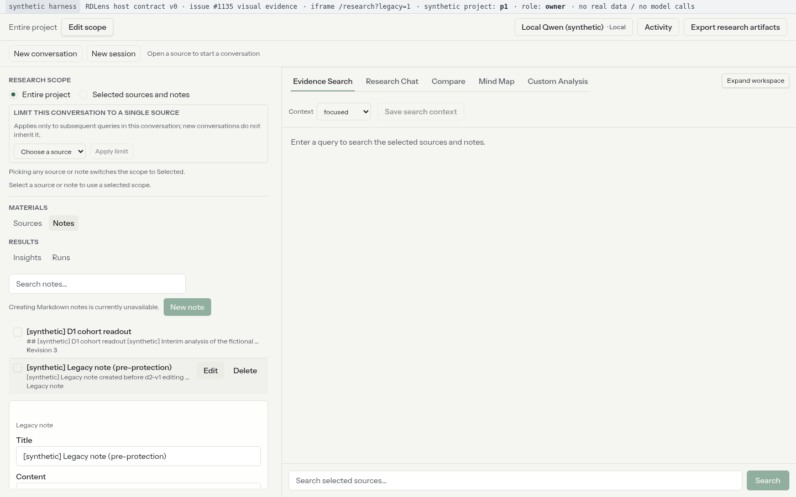
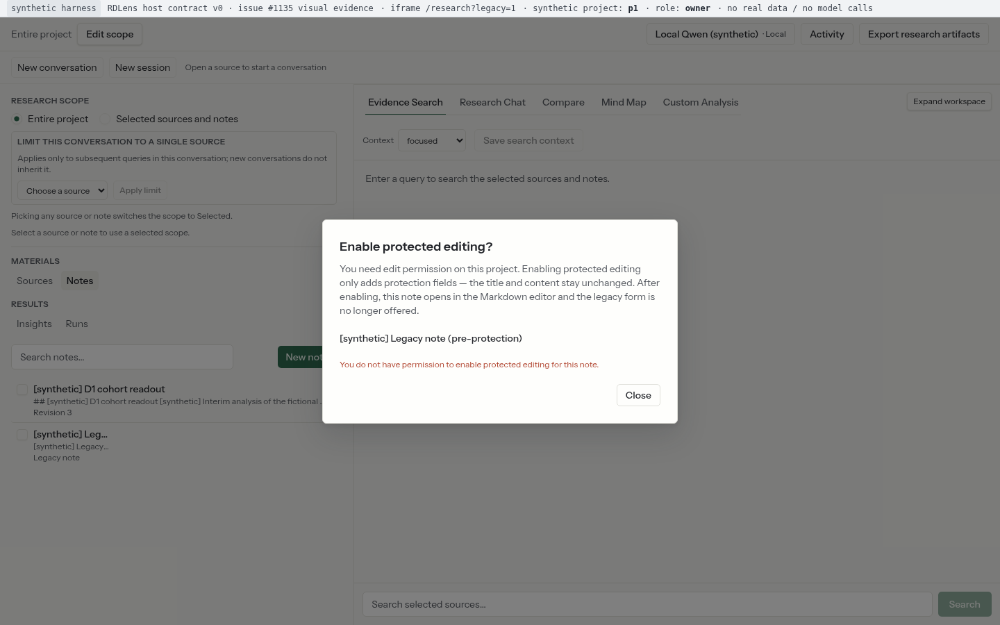
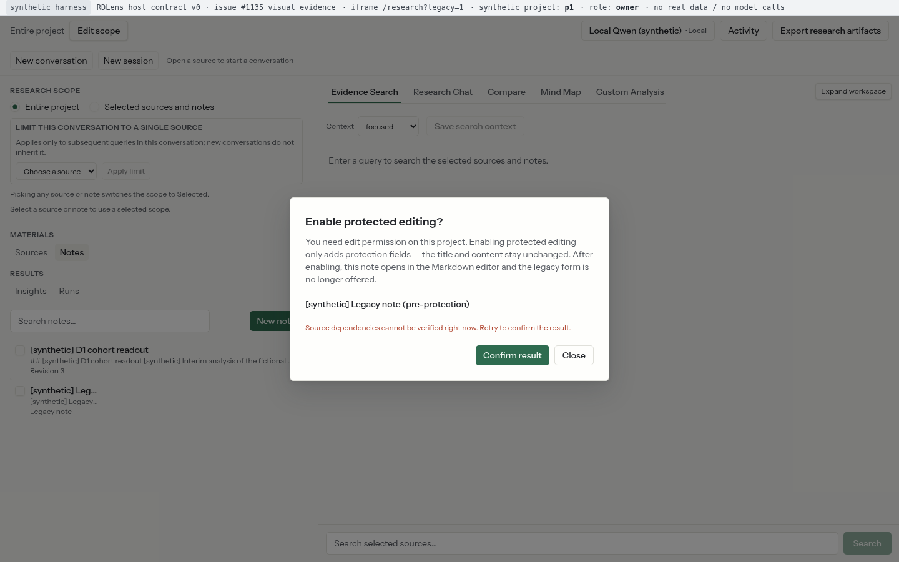
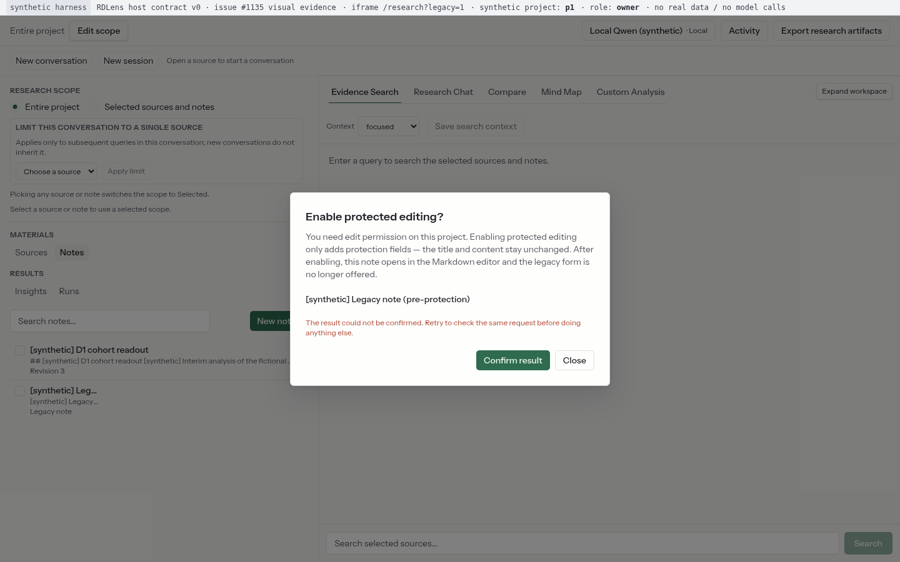
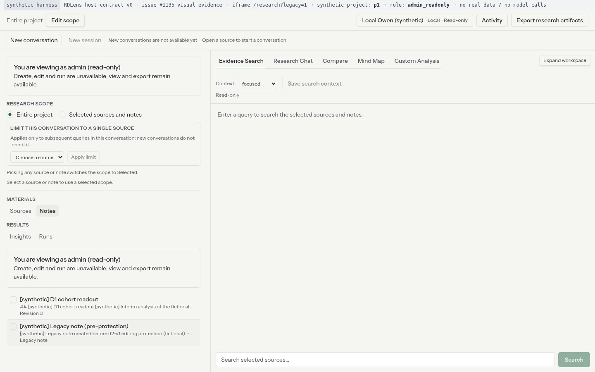
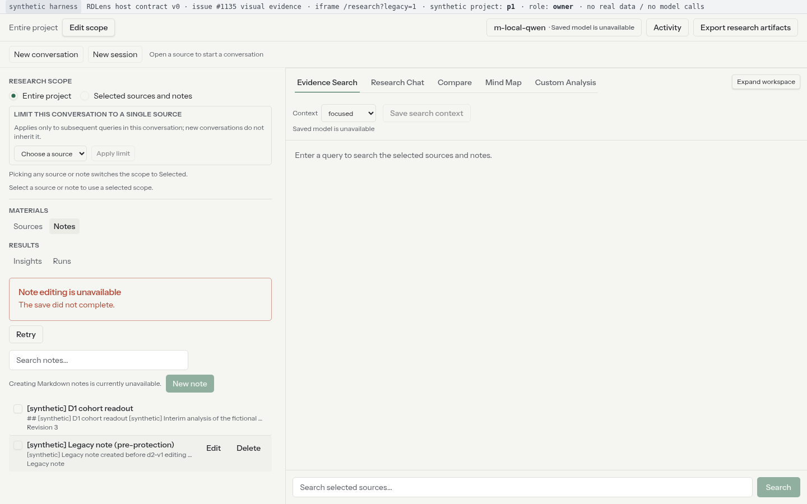

# Issue #1135 — 受保护编辑启用入口（legacy Notes → d2-v1 原地启用）Before/After 合成证据

- **Issue**：`HiFiBiO-Therapeutics/RDLens#1135`（follow-up：#1046 PR4 §8.2〔R31〕的后续入口——旧未保护 Note 的受保护编辑启用）
- **实现**：fork 前端单 PR（`NotesPanel` 入口 + 新增 `NoteEnableDialog` / `note-enable` 状态机 / `use-note-enable` + 14 语言文案 + 单测），实现 head = `deca6257b21bd67f062672dcf005eee2230b09f7`（fork 分支 `agent/protected-edit-ui-c1f827496380`）。
- **证据分支**：`evidence/protected-edit-ui-c1f827496380`（本分支，从 fork `origin/main` 创建，**不属于实现 PR diff**；仅证据文件）。
- **交付要求对应**：UI 变更 PR 的 Before/After 对比——同一场景/视口/主题/状态、标注基线与变更 revision；BEFORE = fork `origin/main` = `34f531d0270587ed1f2bfa02e361c8a3dd0d224d`（含 #1136 终态，**无启用入口**）。

## 结论摘要

| 场景 | BEFORE（fork origin/main 34f531d） | AFTER（实现 head deca625） |
|---|---|---|
| E1 旧未保护 Note 行操作区（Hover） | 只有 `Edit` / `Delete`，无启用入口（`note-enable-*` = 0） | 同一操作区出现 `note-enable-note_legacy`（“Enable protected editing”），`Edit`/`Delete` 保持；未点击前不发任何请求、不开对话框 |
| E2 旧 Note 编辑路径 | 点击 `Edit` 打开**旧表单**（Title/Content，无 revision/保护字段），旧表单保存 200 且 Note 仍 `edit_schema=null` | 点击启用 → `note-enable-dialog`（confirming）→ 确认 → 1 次 `POST .../notes/note_legacy/editing` 200 → **原地打开 d2-v1 Markdown 编辑器**：标题/正文与 fixture 一致、`Revision 1`、Save now 可用、旧表单不再出现、目录行刷新为 `d2-v1`；随后编辑器保存成功（revision 2） |
| E3 能力 `note_editor.available=false` | 无启用入口；旧表单照常打开/预填 | 入口隐藏（fail-closed）；旧表单照常打开/预填（行为不变） |
| E4 403 `note_access_restricted` | N/A（基线无启用入口，不存在该流程） | 对话框内错误态 `note-enable-error`（`data-failure-kind=restricted`），**无重试**（terminal），Note 仍 `edit_schema=null` |
| E5 503 `note_dependency_unavailable` | N/A（同上） | 错误态 `data-failure-kind=unavailable` + `note-enable-retry`；重试（同一 mutation_id）→ 200 → 编辑器打开；`/__stats` 2 次请求（503 → 200），仅 1 次语义变更 |
| E6 结果未知（网关先应用启用再返回 503 `note_store_unavailable`） | N/A（同上） | 对话框提示未知（`data-failure-kind=unknown`），按钮文案 **“Confirm result”**（`research.notes.enable.confirmResult`）；重放后编辑器打开。`/__stats` 证明两次 `POST .../editing` 使用**同一 mutation_id**、第二次为 receipt replay、**启用语义变更恰好 1 次**、仍是同一个 note（无重复文档） |
| E7 Admin 只读 | `admin-readonly-banner` 可见；无启用入口、无 Edit/Delete、无 New note | 同左（Admin 无写/启用入口） |
| E8 能力读取失败（`/models` 500） | fail-closed：`note-capability-blocked` + 重试；无启用入口 | 同左（无启用入口；不把旧表单当受保护编辑回退路径） |

**浏览器行为断言**（真实 headless Chromium 点击 `/__stats` 请求计数，非 mock 断言）：BEFORE `74 PASS / 0 FAIL / 0 scene errors (74 assertions, 10 scene runs)`；AFTER `198 PASS / 0 FAIL / 0 scene errors (198 assertions, 16 scene runs)`。

## 证据性质与公开安全声明（synthetic）

本证据完全合成（synthetic）：

- 运行的是**真实 fork Next.js 应用**（`next dev --webpack`，嵌入式 iframe 模式），但宿主页面是本地合成 host（`harness/host_server.js`），Research Gateway 是**路由 mock**（`harness/gateway_mock.js`），无真实 RDLens host / PostgreSQL / SurrealDB / 真实文件 / 模型调用 / 飞书内容 / 真实用户或项目数据。
- 所有 note 标题/正文/ID、来源、会话均为 `[synthetic]` fixtures（项目 `p1`、viewer `1`），截图顶部合成 host 栏显式标注 “synthetic harness … no real data / no model calls”。
- Token 为**伪造未签名** claims-only JWT（Gateway mock 不验签；真实签名校验在生产 Gateway）；无任何真实凭据/密钥。
- 不包含真实内部项目名、来源名、Note 名或人员信息。

## 修订与分支

| 项 | 值 |
|---|---|
| BEFORE 基线 | fork `origin/main` = `34f531d0270587ed1f2bfa02e361c8a3dd0d224d`（2026-11-10，含 #1136 终态；**无启用入口**） |
| AFTER head | `deca6257b21bd67f062672dcf005eee2230b09f7`（fork 分支 `agent/protected-edit-ui-c1f827496380`；3 commits：`25ed83b` 状态机+hook → `8cb92f8` 入口+对话框 → `deca625` 14 语言文案） |
| 证据分支 | `evidence/protected-edit-ui-c1f827496380`（从 fork `origin/main` 创建；仅 `dev_docs/validation/issue-1135/` 证据文件） |
| 实现改动 | 23 files（`git diff --name-only origin/main deca625`：5 个源文件 = `NotesPanel.tsx` + 新增 `NoteEnableDialog.tsx`/`note-enable.ts`/`use-note-enable.ts` + `note-ui-labels.ts`；14 个语言文件；4 个单测文件；完整列表见 `after-manifest.json.implementation_diff`） |
| Harness | `dev_docs/validation/issue-1135/harness/`（捕获脚本、合成 gateway/host、runbook；公开安全，无密钥） |

## 入口路径说明（重要，如实记录）

fork 前端自 W1 #1104 起，`/research` **默认渲染目标壳 `TargetShell`**；目标壳目前**不挂载 PR4 Notes 编辑器/目录**。旧未保护 Note 的启用入口位于 **legacy 回归入口 `/research?legacy=1`**（D-UI-05 过渡/回归入口，不新增能力）的 `ResearchWorkbench` → `NotesPanel`。

因此：

- 本 Before/After 对比的界面表面是 **`/research?legacy=1`（legacy ResearchWorkbench）**，harness 的 iframe URL 对两侧使用同一入口 `?legacy=1`（截图顶栏记录该入口）。
- **不声称**该入口在默认生产入口（TargetShell）可达；TargetShell 的 Notes 集成属后续工作。
- Before/After 差异仅由实现 head 引入；两侧 fixture、gateway 模式、视口、入口、主题一致。

## 环境与端口

| 项 | BEFORE | AFTER |
|---|---|---|
| Next dev | `node_modules/.bin/next dev --webpack -p 8921` | `... -p 8923` |
| 合成 host | `http://127.0.0.1:8980/`（iframe `http://127.0.0.1:8921/research?legacy=1`） | `http://127.0.0.1:8982/`（iframe `http://127.0.0.1:8923/research?legacy=1`） |
| 合成 Gateway mock | `http://127.0.0.1:8951`（两侧共用同一实现，模式文件驱动） | 同左 |
| 嵌入式 env | `NEXT_PUBLIC_RD_EMBEDDED_MODE=1` / `NEXT_PUBLIC_RD_GATEWAY_URL=http://127.0.0.1:8951` / `NEXT_PUBLIC_RD_PARENT_ORIGIN=http://127.0.0.1:<host>` | 同左（parent origin 各自 host 端口） |
| 视口/主题 | 1440×900、1024×768；light；deviceScaleFactor=1；locale en-US；每个场景全新 browser context | 同左 |
| 浏览器 | headless Chromium `/home/lchen/.cache/ms-playwright/chromium-1243/chrome-linux64/chrome`（`--force-color-profile=srgb`） | 同左 |
| Node | v22.20.0 | 同左 |

> harness-only patch：`frontend/src/lib/embedded/config.ts` 的 `process.env[CONST]` 动态读取改为静态 `process.env.NEXT_PUBLIC_*` 成员访问（Next dev 不内联动态读取；#1046/#1136 证据先例）。该 patch **不属于产品改动**，捕获后已 `git checkout --` 还原。
> 原始/打补丁/还原 sha256：original `2192fb22…42fb6` → patched `255492d4…0dade` → restored `2192fb22…42fb6`（两侧同一原文件；两个 worktree `restored_clean=true`）；两个 worktree 最终 `git status --porcelain` 均为空（见 `before/after-manifest.json` 的 `worktree_provenance`）。

## 合成 Harness 组成与驱动方式

- `harness/host_server.js`：合成宿主页，完成 research-v0 `ready → token` 握手（伪造 claims-only token），iframe 上方 24px 合成 host 栏（标注 synthetic harness / 当前 synthetic project / role / 入口 / no real data）。`?role=admin_readonly` 让初始 token claim 变成 Admin 只读（E7）。
- `harness/gateway_mock.js` + `harness/fixtures.js`：路由 mock 的 Research Gateway（d2-v1 note API、能力投影、`/v1/research/projects/<id>/...` 按后缀匹配）。**#1135 新增** `POST .../notes/{id}/editing` 行为模式（模式文件 `/tmp/issue1135-enable-mode`）：
  - `success`：应用启用（`edit_schema=null → d2-v1`，revision 1，写 receipt），返回 `{note, receipt}`；同一 mutation_id 重放 → 200 `replayed:true`（不再变更）；
  - `already_protected`：已保护 Note 幂等成功（`receipt:null`，不增 revision）；
  - `restricted403`：403 `note_access_restricted`（retryable=false，终态）；
  - `dependency503`：首个请求 503 `note_dependency_unavailable`（retryable=true，未应用）；重试成功；
  - `unknown503_apply`：**先应用启用**再返回 503 `note_store_unavailable`（结果未知）；同一 mutation_id 重放 → receipt replay；
  - `network_error_apply`：先应用启用再断连（传输级未知；代码保留，未用于本证据场景）。
  能力模式由 `/tmp/issue1135-note-mode` 驱动：`editor_on` / `editor_off` / `existing_off` / `models_error` / `models_malformed`。
  `/__reset` 每场景重置；`/__stats` 提供每次 `POST .../editing` 的 `note_id / mutation_id / outcome / status`、实际语义变更（`enable_applies`）、`saves`、notes 投影；`/__note` 提供当前 Note。
- **真实 UI 驱动**：只通过真实点击/输入（`note-enable-<id>`、`note-enable-confirm`、`note-enable-retry`、旧表单 `Edit`/`Save`、编辑器 textarea/`Save now`、group-nav `Notes`、`window.__hostSendToken` 仅用于 Admin role 的 token 重发）；不调用应用内部 API。
- **角色驱动（E7）**：合成 host `?role=admin_readonly` → 初始 research-v0 token 的 `role` claim 为 `admin_readonly`（与真实宿主签发契约一致；host 栏显示 `role: admin_readonly`）。
- 映射到 issue 场景：E4 → `restricted403`；E5 → `dependency503`；E6 → `unknown503_apply`；E8 → `models_error`（500）。

## 场景与截图

命名 `<side>_<scene>_<width>.png`；每个场景在 1440×900 与 1024×768 各采一次（下表以 1440 缩略引用，全部文件见 `screenshots/{before,after}/` 与 `screenshots.sha256`）。

| 场景 | BEFORE | AFTER |
|---|---|---|
| E1 旧 Note 行操作区（Hover） | `before_e1_row_actions`：仅 Edit/Delete，无启用入口 | `after_e1_row_actions`：`Enable protected editing` 入口可见，Edit/Delete 保留 |
| E2 旧 Note 编辑路径 | `before_e2_legacy_form`（旧表单）→ `before_e2_legacy_saved`（旧表单保存后 Note 仍 legacy） | `after_e2_enable_dialog`（确认对话框）→ `after_e2_editor_opened`（原地 d2-v1 编辑器，Revision 1）→ `after_e2_editor_saved`（编辑器保存成功） |
| E3 能力关闭 | `before_e3_capability_off_legacy_form`：旧表单照常 | `after_e3_capability_off_legacy_form`：入口隐藏、旧表单照常 |
| E4 403 restricted | N/A（基线缺口，见 manifest `before_na_scenes`） | `after_e4_restricted_error`：错误态 + 无重试 |
| E5 503 dependency + 重试 | N/A | `after_e5_dependency_error`（错误+重试）→ `after_e5_retry_editor`（重试成功编辑器） |
| E6 未知结果 → 同 mutation 确认 | N/A | `after_e6_unknown_result`（“Confirm result”）→ `after_e6_confirmed_editor`（重放后编辑器） |
| E7 Admin 只读 | `before_e7_admin_readonly`：无启用/写入口 | `after_e7_admin_readonly`：无启用/写入口 |
| E8 能力读取失败 | `before_e8_capability_error`：fail-closed 阻断提示，无启用入口 | `after_e8_capability_error`：同左 |

## 浏览器行为断言（Before vs After）

每场景在两种视口各跑一遍（10 BEFORE scene runs / 16 AFTER scene runs）；每条断言记录 expected/actual 到 `capture.log`，汇总在 `before-manifest.json` / `after-manifest.json` 的 `scenes[].assertions`；截图时刻的 DOM testid 计数与 gateway 计数记录在 `screenshots[].dom_counts` / `gateway_stats`。

### BEFORE（基线缺口）

| 场景 | 关键断言（全部 PASS） | 计数（两视口合计） |
|---|---|---|
| E1 旧 Note 行操作区（Hover） | `e1.legacy_row_present`、`e1.legacy_row_is_unprotected`、`e1.row_hovered`、`e1.before_legacy_edit_delete_actions`、`e1.before_no_enable_entry`、`e1.no_enable_request_on_row_view`、`e1.no_console_or_page_errors` | 14 |
| E2 旧 Note 编辑路径（旧表单 / 启用→原地 d2-v1） | `e2.before_edit_action_clicked`、`e2.before_legacy_form_opened`、`e2.before_legacy_form_prefilled`、`e2.before_no_protected_editor_or_revision`、`e2.before_no_enable_entry`、`e2.before_legacy_save_succeeds`、`e2.before_legacy_save_updates_note`、`e2.before_note_stays_unprotected`、`e2.no_console_or_page_errors` | 18 |
| E3 能力关闭（note_editor=false） | `e3.row_hovered`、`e3.capability_off_known`、`e3.models_request_seen`、`e3.before_no_enable_entry`、`e3.legacy_edit_action_clicked`、`e3.legacy_form_kept`、`e3.legacy_form_prefilled`、`e3.no_protected_editor_with_form`、`e3.no_console_or_page_errors` | 18 |
| E4 403 restricted（终态） | N/A | 0 |
| E5 503 dependency + 重试 | N/A | 0 |
| E6 未知结果 → 同 mutation 确认 | N/A | 0 |
| E7 Admin 只读 | `e7.admin_banner_visible`、`e7.no_enable_entry_for_admin`、`e7.no_legacy_write_actions_for_admin`、`e7.no_catalog_create_for_admin`、`e7.no_enable_request_for_admin`、`e7.no_console_or_page_errors` | 12 |
| E8 能力读取失败 fail-closed | `e8.capability_blocked_shown`、`e8.no_enable_entry_on_capability_failure`、`e8.capability_retry_offered`、`e8.models_request_failed_and_observed`、`e8.no_enable_request`、`e8.no_unexpected_console_or_page_errors` | 12 |

### AFTER（实现验收）

| 场景 | 关键断言（全部 PASS） | 计数（两视口合计） |
|---|---|---|
| E1 旧 Note 行操作区（Hover） | `e1.legacy_row_present`、`e1.legacy_row_is_unprotected`、`e1.row_hovered`、`e1.after_enable_entry_visible`、`e1.after_enable_entry_visible_after_hover`、`e1.after_legacy_edit_delete_kept`、`e1.after_no_dialog_before_click`、`e1.no_enable_request_on_row_view`、`e1.no_console_or_page_errors` | 18 |
| E2 旧 Note 编辑路径（旧表单 / 启用→原地 d2-v1） | `e2.enable_entry_clicked`、`e2.enable_dialog_opened`、`e2.dialog_has_confirm_and_cancel`、`e2.dialog_mentions_enabling_protected_editing`、`e2.dialog_phase_confirming`、`e2.confirm_clicked`、`e2.editor_opened_in_place`、`e2.editor_title_unchanged`、`e2.editor_content_unchanged`、`e2.editor_revision_shown`、`e2.save_available`、`e2.old_legacy_form_gone`、`e2.enable_entry_gone_after_enable`、`e2.catalog_row_refreshed_to_d2_v1`、`e2.dialog_closed_after_success`、`e2.typed_into_enabled_editor`、`e2.enabled_editor_saves`、`e2.exactly_one_enable_request`、`e2.enable_request_succeeded`、`e2.server_note_now_protected`、`e2.enabled_note_saved_content`、`e2.save_request_was_d2`、`e2.no_console_or_page_errors` | 46 |
| E3 能力关闭（note_editor=false） | `e3.row_hovered`、`e3.capability_off_known`、`e3.models_request_seen`、`e3.after_no_enable_entry_when_capability_off`、`e3.legacy_edit_action_clicked`、`e3.legacy_form_kept`、`e3.legacy_form_prefilled`、`e3.no_protected_editor_with_form`、`e3.no_console_or_page_errors` | 18 |
| E4 403 restricted（终态） | `e4.enable_entry_clicked`、`e4.confirm_clicked`、`e4.error_state_shown`、`e4.error_has_failure_kind`、`e4.error_kind_is_restricted`、`e4.error_dialog_stays_open`、`e4.no_retry_for_terminal_error`、`e4.single_restricted_request`、`e4.no_semantic_change`、`e4.note_still_unprotected`、`e4.no_console_or_page_errors` | 22 |
| E5 503 dependency + 重试 | `e5.enable_entry_clicked`、`e5.confirm_clicked`、`e5.error_state_shown`、`e5.error_kind_is_unavailable`、`e5.error_dialog_stays_open`、`e5.retry_offered`、`e5.retry_clicked`、`e5.editor_opened_after_retry`、`e5.editor_title_unchanged`、`e5.editor_revision_shown`、`e5.two_attempts_recorded`、`e5.first_retryable_second_success`、`e5.exactly_one_semantic_change`、`e5.no_console_or_page_errors` | 28 |
| E6 未知结果 → 同 mutation 确认 | `e6.enable_entry_clicked`、`e6.confirm_clicked`、`e6.unknown_state_shown`、`e6.unknown_kind_reported`、`e6.unknown_dialog_stays_open`、`e6.confirm_result_action_present`、`e6.confirm_result_label_is_dedicated`、`e6.first_attempt_recorded_unknown`、`e6.mutation_id_present`、`e6.confirm_result_clicked`、`e6.editor_opened_after_confirm_result`、`e6.editor_title_unchanged`、`e6.editor_content_unchanged`、`e6.editor_revision_is_one`、`e6.two_requests_recorded`、`e6.same_mutation_id_replayed`、`e6.second_attempt_replayed_receipt`、`e6.exactly_one_semantic_change`、`e6.final_state_single_protected_document`、`e6.no_duplicate_note_created`、`e6.no_console_or_page_errors` | 42 |
| E7 Admin 只读 | `e7.admin_banner_visible`、`e7.no_enable_entry_for_admin`、`e7.no_legacy_write_actions_for_admin`、`e7.no_catalog_create_for_admin`、`e7.no_enable_request_for_admin`、`e7.no_console_or_page_errors` | 12 |
| E8 能力读取失败 fail-closed | `e8.capability_blocked_shown`、`e8.no_enable_entry_on_capability_failure`、`e8.capability_retry_offered`、`e8.models_request_failed_and_observed`、`e8.no_enable_request`、`e8.no_unexpected_console_or_page_errors` | 12 |

合计：BEFORE `74 PASS / 0 FAIL / 0 scene errors (74 assertions, 10 scene runs)`；AFTER `198 PASS / 0 FAIL / 0 scene errors (198 assertions, 16 scene runs)`；两阶段均 **0 unexpected console/page error**（仅记录 intentional 失败模式触发的 Chromium “Failed to load resource … 403/500/503” 资源日志，按预期模式单独记录，非应用 console error）。

### 请求计数（`/__stats`，每个场景一次 reset）

| 场景 | BEFORE（`/__stats`） | AFTER（`/__stats`） |
|---|---|---|
| E1 | 0× `POST .../editing` | 0× `POST .../editing` |
| E2 | 0× `POST .../editing`；旧表单 PATCH 1× (200) | 1× `POST .../editing`: success/200；语义变更 1× |
| E3 | 0× `POST .../editing` | 0× `POST .../editing` |
| E4 | N/A | 1× `POST .../editing`: restricted/403；语义变更 0× |
| E5 | N/A | 2× `POST .../editing`: dependency_unavailable/503 → success/200；语义变更 1× |
| E6 | N/A | 2× `POST .../editing`: unknown_applied/503 → replayed/200；语义变更 1× |
| E7 | 0× `POST .../editing` | 0× `POST .../editing` |
| E8 | 0× `POST .../editing` | 0× `POST .../editing` |

## 关键截图（缩略）

| 证据点 | BEFORE | AFTER |
|---|---|---|
| E1 旧 Note 行操作区（Hover） |  |  |
| E2 旧表单 vs 启用对话框 |  |  |
| E2 启用后原地 d2-v1 编辑器 | —（基线无该路径） |  |
| E3 能力关闭：入口隐藏、旧表单保持 |  |  |
| E4 403 restricted（终态错误） | —（基线缺口 N/A） |  |
| E5 503 dependency → 重试成功 | —（N/A） |  →  |
| E6 未知 → “Confirm result” 重放 | —（N/A） |  →  |
| E7 Admin 只读 |  |  |
| E8 能力读取失败 fail-closed |  |  |

## 本地校验（fork 无 PR CI，local-only）

fork 仓库未配置 GitHub Actions checks，因此以本地命令结果为校验证据（命令与退出码同时写入 `after-manifest.json` 的 `local_verification`，完整输出见 `logs/local-verification.txt`）：

```
head=deca6257b21bd67f062672dcf005eee2230b09f7 tsc=0 eslint=0 vitest=0 build=0 full=1
# tsc -b: exit 0
# eslint (23 changed/new files): exit 0, 0 problems
# targeted vitest: 4 files / 107 tests passed, exit 0
# next production build: exit 0
# full suite: Tests 14 failed | 3027 passed (3041) → exit 1
#   14 failed = pre-existing SourceListPanel.test.tsx baseline failures
#   (identical at origin/main 34f531d: that file alone is 14 failed | 1 passed)
#   → not caused by this change; all other 182 test files pass
```

## 复现

```bash
# 1) 准备 worktree（node_modules 用 symlink；本环境不 npm install）
git -C <fork-repo> worktree add --detach <scratch>/fork-before 34f531d0270587ed1f2bfa02e361c8a3dd0d224d
git -C <fork-repo> worktree add --detach <scratch>/fork-after deca6257b21bd67f062672dcf005eee2230b09f7
ln -s <fork-repo>/frontend/node_modules <scratch>/fork-before/frontend/node_modules
ln -s <fork-repo>/frontend/node_modules <scratch>/fork-after/frontend/node_modules

# 2) BEFORE（合成 gateway/host 由脚本启动；端口 8921/8980/8951）
WT_BEFORE=<scratch>/fork-before dev_docs/validation/issue-1135/harness/run_before.sh

# 3) AFTER（端口 8923/8982/8951；脚本会 checkout SHA 并记录/还原 harness patch）
WT_AFTER=<scratch>/fork-after AFTER_SHA=deca6257b21bd67f062672dcf005eee2230b09f7 \
  dev_docs/validation/issue-1135/harness/run_after_final.sh

# 4) 本地校验 + 清单（tsc/eslint/targeted vitest/build/全量、worktree 清洁度、config patch hash、screenshots.sha256）
WT_BEFORE=<scratch>/fork-before WT_AFTER=<scratch>/fork-after \
  AFTER_SHA=deca6257b21bd67f062672dcf005eee2230b09f7 \
  dev_docs/validation/issue-1135/harness/finalize_evidence.sh
```

## 限制（NOT RUN / 如实记录）

1. **合成 harness + `next dev`**：证据证明前端行为与契约接线（真实浏览器、真实请求计数），不替代真实 host/DB/真实权限数据/真实模型证据；Research Gateway 为路由 mock。
2. **入口 surface**：如“入口路径说明”，对比发生在前端 legacy 回归入口 `?legacy=1` 的 `ResearchWorkbench`；默认 `TargetShell` 的 Notes 集成不在本 issue 范围，**不声称生产默认入口可达**。
3. **E4/E5/E6 的 BEFORE 为 N/A**：基线 34f531d 根本没有启用入口/启用 mutation（`enableNoteEditing` 客户端方法虽在 PR4 冻结契约中存在，但无 UI 调用路径），无法在基线重现这些错误/未知状态；未伪造基线截图。
4. **错误注入为网关路由 mock**：403/503/未知/断连由 mock 按契约错误信封返回；不覆盖真实 Gateway/存储/依赖的故障注入（真实依赖不可判定语义由宿主测试覆盖）。
5. **非确定性**：next dev/HMR 加载帧、toast 出现时机、catalog 刷新瞬间的 loading 文案会随运行时刻不同；**不声称截图跨次运行 byte-identical**；`screenshots.sha256` 只对本次提交的快照有效。
6. **intentional HTTP 失败**：`restricted403`/`dependency503`/`unknown503_apply`/`models_error` 会让 Chromium 记录资源级 “Failed to load resource … 403/500/503” console 条目（浏览器自动日志）；已与意外 page/console error 分开记录，本证据断言 **unexpected = 0**。
7. **light/en-US 单主题**、两档视口（1440×900 / 1024×768）；未覆盖 dark/RTL/移动宽度/键盘或 IME 实体输入（实现仓单测覆盖交互边界）。
8. **未覆盖**：`already_protected` 幂等分支（网关已实现模式，未单独截图/断言；由实现仓 `note-enable.test.ts` 覆盖）、`models_malformed` 畸形能力响应（仅实现 `models_error` 500 场景；畸形响应由 `readNoteCapabilities` 单测覆盖）、断连型未知（`network_error_apply` 未用于场景；E6 用 503 未知）、真实并发/多标签、真实用户权限矩阵。
9. **本地全量测试**：全量 vitest = `14 failed | 3027 passed (3041)`。14 个失败全部来自既有 `src/components/research/SourceListPanel.test.tsx`（在该文件上 `14 failed | 1 passed (15)`），并在 BEFORE 基线 worktree（`origin/main` 34f531d）上**逐字复现**（见 `logs/baseline-sourceListPanel-at-origin-main.txt`），与 #1136 证据记录的基线失败一致；因此不作为本 PR 的 pass/fail 门槛，仅记录。

## 文件清单

| 文件 | 说明 |
|---|---|
| `dev_docs/validation/issue-1135/README.md` | 本文件 |
| `screenshots/before/*.png` / `screenshots/after/*.png` | Before/After 截图（`12` + `24` = 36 张；每张均有 1440×900 与 1024×768 两档；AFTER 场景 E2/E5/E6 各含中间态与终态两张） |
| `screenshots.sha256` | 全部截图的 sha256 |
| `capture.log` | 逐命令/逐截图/DOM testid 计数/`/__stats`/console 证据日志（BEFORE 部分由 BEFORE 捕获运行的 stdout 还原，AFTER 部分由 AFTER 捕获运行直接追加；内容等价） |
| `before-manifest.json` / `after-manifest.json` | 修订（full SHA）、环境、场景、断言、计数、截图 sha256、worktree 清洁度、config patch hash、本地校验结果、实现 diff |
| `logs/` | gateway/host/dev 日志、config patch provenance、worktree provenance、本地校验输出 |
| `harness/` | 可复现 harness（capture.js、host_server.js、gateway_mock.js、fixtures.js、run_*.sh、verify_local.sh、finalize_evidence.sh、probe.js） |
