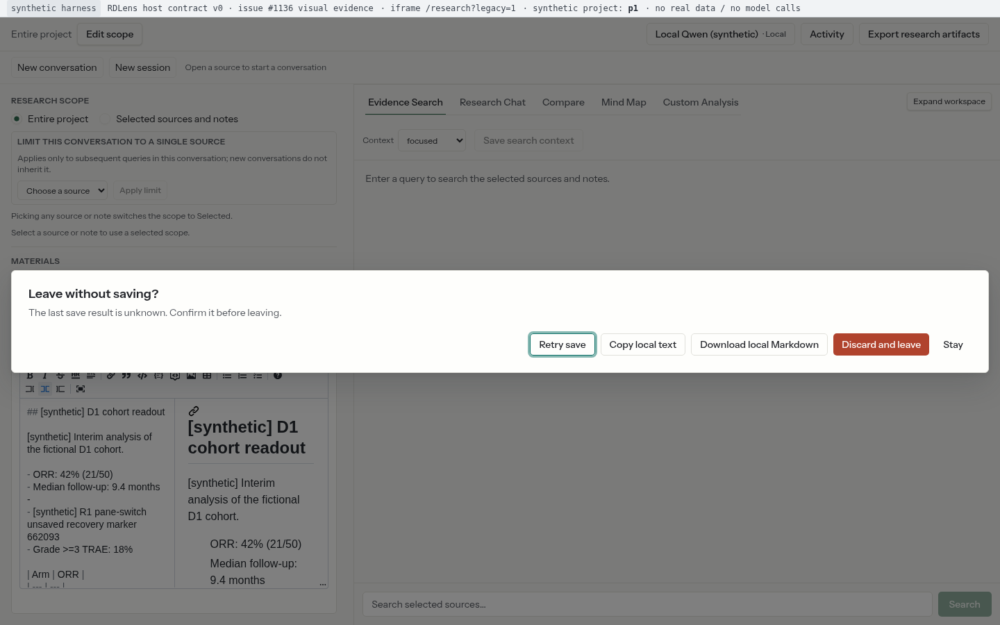
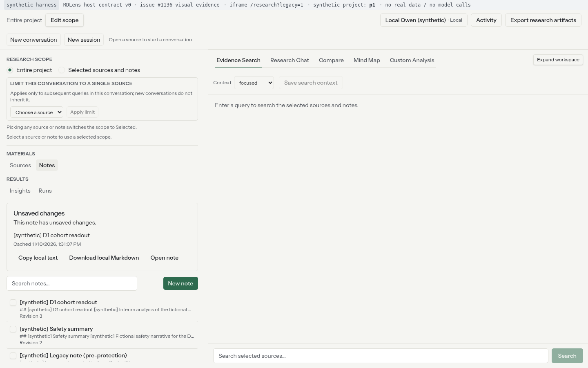
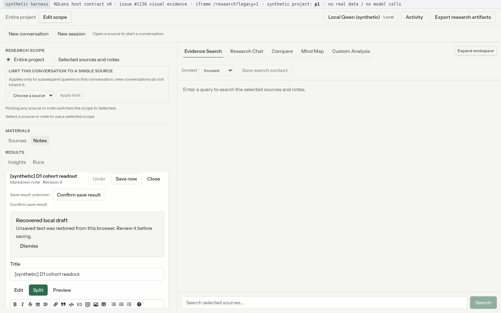
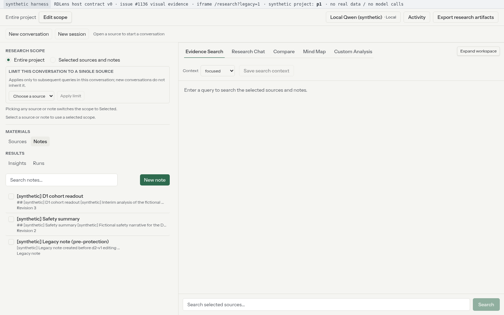
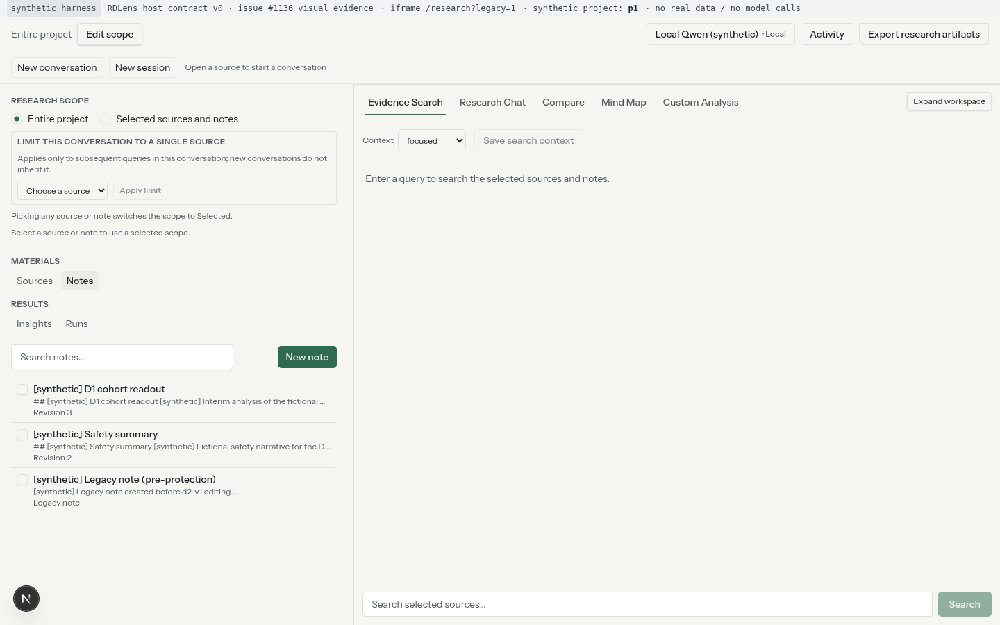
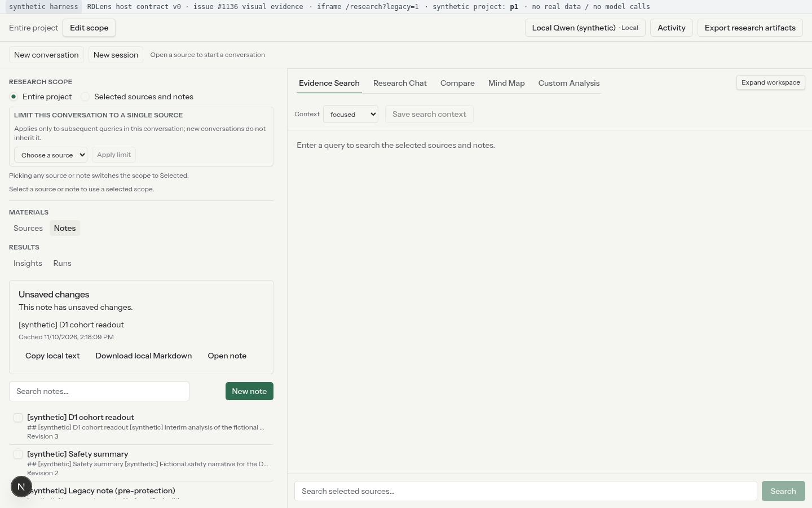
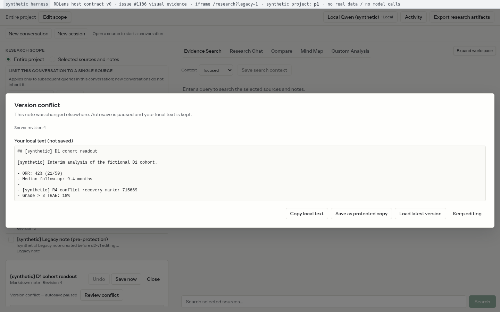

# Issue #1136 — 应用内父级导航的离开保护（fork ResearchWorkbench 层）Before/After 合成证据

- **Issue**：`HiFiBiO-Therapeutics/RDLens#1136`（follow-up：#1046 PR4 审查 A MEDIUM-3 / PR #116「NOT RUN」节）
- **Owner 方案**：**自动保存＋可恢复（不阻断导航）**——父级导航（切 pane／切项目／页面跳转）不弹阻断框；服务端保存未完成（失败/未知/冲突）时，回到 Notes 目录显式列出本标签页可恢复草稿，点「打开笔记」恢复正文与 PR4 既有恢复横幅/保存状态。
- **实现**：fork 前端单点改动（`ResearchWorkbench.tsx` pane 切换前回调 + `NotesPanel.tsx` 注册离开前 handler + 新增 `NoteRecoveryInbox` + 复用 PR4 `note-draft-cache`/`use-note-editor`），实现 head = `46574030584ed3bfa11b75665c5fbf03fdb2ed52`。
- **证据分支**：`evidence/issue1136-leave-guard-20261110`（本分支，从 fork `origin/main` 创建，**不属于实现 PR diff**）。

## 结论摘要

| 场景 | BEFORE（fork origin/main） | AFTER（实现 head） |
|---|---|---|
| R1 pane 切换（保存失败/未知） | 父级切 pane **静默成功**，Notes 目录无任何恢复提示；草稿只在本地缓存，必须**恰好手动重开同一篇**才看到 PR4 恢复横幅 | 回到 Notes 目录出现 `note-recovery-inbox`（标题/行/`Open note`）；点击后编辑器恢复草稿正文 + `note-draft-restored` + 保存状态（unknown） |
| R2 项目切换 p1→p2→p1 | 无恢复入口；草稿缓存仍在但用户无从发现 | 绑定 p2 时**不显示** p1 草稿（按 owner/project 作用域）；回到 p1 Notes 出现 inbox；打开后恢复草稿（先经 `GET /notes/{id}` 权限确认） |
| R3 整页刷新 | 无恢复入口；刷新后草稿仍在本地缓存但不可发现 | 刷新后 Notes 出现 inbox；打开后恢复草稿正文/横幅/状态 |
| R4 版本冲突 | 无恢复入口 | Notes 出现 inbox；打开后恢复草稿正文，并显示 PR4 既有冲突对话框（Server revision 4、本地未保存文本）+ 冲突保存状态 |
| R5 稳态对照（保存成功） | 无 inbox（无残留草稿） | 无 inbox（ACK 后草稿缓存已清理，无陈旧恢复提示） |

**浏览器行为断言**：BEFORE `96 PASS / 0 FAIL / 0 scene errors (96 assertions, 10 scene runs)`；AFTER `154 PASS / 0 FAIL / 0 scene errors (154 assertions, 10 scene runs)`（全部断言均为真实 headless Chromium 驱动真实 fork Next.js 应用 + 真实 `/__stats` 请求计数，非 mock 断言）。

## 证据性质与公开安全声明（synthetic）

本证据完全合成（synthetic）：

- 运行的是**真实 fork Next.js 应用**（`next dev --webpack`，嵌入式 iframe 模式），但宿主页面是本地合成 host（`harness/host_server.js`），Research Gateway 是**路由 mock**（`harness/gateway_mock.js`），无真实 RDLens host / PostgreSQL / SurrealDB / 真实文件 / 模型调用 / 飞书内容 / 真实用户或项目数据。
- 所有 note 标题/正文/ID、来源、会话均为 `[synthetic]` fixtures（项目 `p1`/`p2`、viewer `1`），截图顶部合成 host 栏显式标注 “synthetic harness … no real data / no model calls”。
- Token 为**伪造未签名** claims-only JWT（Gateway mock 不验签；真实签名校验在生产 Gateway）；无任何真实凭据/密钥。
- 不包含真实内部项目名、来源名、Note 名或人员信息。

## 修订与分支

| 项 | 值 |
|---|---|
| BEFORE 基线 | fork `origin/main` = `a4a76170c5016d0c4cfefae505aa8369be568a96`（2026-11-10） |
| AFTER head | `46574030584ed3bfa11b75665c5fbf03fdb2ed52`（fork 分支 `agent/leave-guard-798df570c13c`） |
| 证据分支 | `evidence/issue1136-leave-guard-20261110`（从 fork origin/main 创建；仅证据文件） |
| 实现改动 | **8 files** = 4 源文件（`NotesPanel.tsx`、`ResearchWorkbench.tsx`、新增 `NoteRecoveryInbox.tsx`、`note-draft-cache.ts`）+ 4 个对应测试文件；`use-note-editor.ts` 及其测试与 `origin/main` 逐字节相同（**未改**；项目切换由 PR4 既有 unmount cleanup 持久化），见实现 PR。核对：`git diff --name-only origin/main 46574030584ed3bfa11b75665c5fbf03fdb2ed52 | wc -l` = 8 |
| Harness | `dev_docs/validation/issue-1136/harness/`（捕获脚本、合成 gateway/host、runbook；公开安全，无密钥） |

## 入口路径说明（重要，如实记录）

fork 前端自 W1 #1104 起，`/research` **默认渲染目标壳 `TargetShell`**；目标壳目前**不挂载 PR4 Notes 编辑器**。PR4 Notes 目录/编辑器与本 issue #1136 的父级导航保护均位于 **legacy 回归入口 `?legacy=1`**（D-UI-05 过渡/回归入口，不新增能力）的 `ResearchWorkbench` 表面。

因此：

- 本 Before/After 对比的界面表面是 **`/research?legacy=1`（legacy ResearchWorkbench）**，harness 的 iframe URL 对两侧使用同一入口 `?legacy=1`（截图顶栏也记录该入口）。
- **不声称**该保护在默认生产入口（TargetShell）可达；TargetShell 的 Note 集成属后续 W3 工作。
- Before/After 差异仅由实现 head 引入；两侧 fixture、gateway 模式、视口、入口一致。

## 环境与端口

| 项 | BEFORE | AFTER |
|---|---|---|
| Next dev | `node_modules/.bin/next dev --webpack -p 8911` | `... -p 8913` |
| 合成 host | `http://127.0.0.1:8972/`（iframe `http://127.0.0.1:8911/research?legacy=1`） | `http://127.0.0.1:8974/`（iframe `http://127.0.0.1:8913/research?legacy=1`） |
| 合成 Gateway mock | `http://127.0.0.1:8941`（两侧共用） | 同左 |
| 嵌入式 env | `NEXT_PUBLIC_RD_EMBEDDED_MODE=1` / `NEXT_PUBLIC_RD_GATEWAY_URL=http://127.0.0.1:8941` / `NEXT_PUBLIC_RD_PARENT_ORIGIN=http://127.0.0.1:<host>` | 同左（parent origin 各自 host 端口） |
| 视口/主题 | 1440×900、1024×768；light；deviceScaleFactor=1；locale en-US；每个场景全新 browser context | 同左 |
| 浏览器 | headless Chromium `/home/lchen/.cache/ms-playwright/chromium-1243/chrome-linux64/chrome`（`--force-color-profile=srgb`） | 同左 |
| Node | v22.20.0 | 同左 |

> harness-only patch：`frontend/src/lib/embedded/config.ts` 的 `process.env[CONST]` 动态读取改为静态 `process.env.NEXT_PUBLIC_*` 成员访问（Next dev 不内联动态读取；PR4 先例）。该 patch **不属于产品改动**，捕获后已 `git checkout --` 还原。
> 原始/打补丁/还原 sha256：original `2192fb22…42fb6` → patched `255492d4…0dade` → restored `2192fb22…42fb6`（两侧同一原文件；两个 worktree `restored_clean=true`）；两个 worktree 最终 `git status --porcelain` 均为空（见 `after-manifest.json` 的 `worktree_provenance`）。

## 合成 Harness 组成与驱动方式

- `harness/host_server.js`：合成宿主页，完成 research-v0 `ready → token` 握手（伪造 claims-only token），并在 iframe 上方提供 24px 合成 host 栏（标注 synthetic harness / 当前 synthetic project / 入口 / no real data）。
- `harness/gateway_mock.js` + `harness/fixtures.js`：路由 mock 的 Research Gateway（d2-v1 note API、能力投影、`/v1/research/projects/<id>/...` 路径按后缀匹配）。保存模式由 `/tmp/issue1046-save-mode` 驱动：`success` / `unknown503` / `conflict`（另有 `network_error`/`slow` 未用于本证据）。`/__reset` 每场景重置，`/__stats` 提供请求计数，`/__bump` 模拟他处编辑推进 revision。
- **真实 UI 驱动**：只通过真实点击/输入（`note-open-<id>`、Markdown 编辑器 textarea、`Sources`/`Notes` group-nav 按钮、`note-recovery-open-<id>`、冲突对话框按钮等）；不调用应用内部 API。
- **项目切换驱动方式（如实记录）**：合成 host 暴露小型 dev hook `window.__hostSendToken(projectId)`——在**同一 channel/nonce** 上重发 research-v0 `token` 消息（与真实宿主切换项目的契约路径一致，含可选 `project.name`）。legacy shell 不展示项目名（项目身份由宿主页承担），故 R2 的切换断言 = host hook 返回 + Gateway 出现 `/v1/research/projects/p2/...` 请求 + workspace 重挂载（Notes 目录消失回默认 Sources pane）；合成 mock 对 p1/p2 返回同一 fixture 投影（**数据隔离不在本证据范围**）。
- **刷新驱动**：R3 使用浏览器真实 `page.reload()`；出现 beforeunload 提示时按“用户选择离开”接受（日志记录），随后 host 自动重新握手。
- 映射到 issue 场景：保存失败/未知 → `unknown503`；版本冲突 → `revision bump + conflict`；稳态对照 → `success`。

## 场景与截图

命名 `<side>_<scene>_<width>.png`；均为 1440×900 与 1024×768 两档（下表以 1440 缩略引用，全部文件见 `screenshots/{before,after}/` 与 `screenshots.sha256`）。

| 场景 | BEFORE | AFTER |
|---|---|---|
| R1 pane 切换（Notes→Sources→Notes，保存结果未知） | `before_r1_editor_guard`（PR4 编辑器级守卫，见下节）→ `before_r1_pane_switch`：目录无恢复提示 →（基线限制）`before_r1_manual_reopen`：只有手动重开同一篇才出现恢复横幅 | `after_r1_pane_switch`：目录出现恢复 inbox（标题/`Cached …` + `Open note`/`Copy local text`/`Download local Markdown`）→ `after_r1_restored`：恢复横幅+unknown 保存状态 → `after_r1_restored_draft`：编辑器中的恢复草稿正文 |
| R2 项目切换 p1→p2→p1（同一保存失败态） | `before_r2_project_p2`：绑定 p2 时目录无 p1 草稿提示（合成 host 栏显示 `synthetic project: p2`）→ `before_r2_project_switch`：回到 p1 后目录仍无恢复提示 | `after_r2_project_p2`：p2 下无 p1 草稿提示 → `after_r2_project_switch`：回 p1 出现 inbox → `after_r2_restored` / `after_r2_restored_draft`：打开后恢复草稿+横幅+状态（先 GET 权限确认） |
| R3 整页刷新（同一保存失败态） | `before_r3_reload`：刷新后目录无恢复提示 | `after_r3_reload`：刷新后 inbox → `after_r3_restored` / `after_r3_restored_draft`：恢复草稿+横幅+状态 |
| R4 版本冲突（bump 后 autosave 409） | `before_r4_conflict`：冲突后切 pane 再回目录，无恢复提示 | `after_r4_conflict`：inbox → `after_r4_conflict_restored`：PR4 冲突对话框（Server revision 4 + 本地未保存文本）→ `after_r4_conflict_restored_editor`：关对话框后恢复横幅+conflict 状态 |
| R5 稳态对照（保存成功） | `before_r5_steady_state`：无 inbox（无陈旧草稿） | `after_r5_steady_state`：无 inbox（ACK 后草稿缓存清理） |

## 浏览器行为断言（Before vs After）

每场景在两种视口各跑一遍；每条断言记录 expected/actual 到 `capture.log`，汇总在 `before-manifest.json` / `after-manifest.json` 的 `scenes[].assertions`；截图时刻的 DOM testid 计数与 gateway 计数记录在 `screenshots[].dom_counts` / `gateway_stats`。

### BEFORE（基线缺口）

| 场景 | 关键断言（全部 PASS） | 计数 |
|---|---|---|
| R1 | `editor_level_guard_auto_opened`（PR4 编辑器级守卫自动打开）；`before_no_recovery_inbox_in_catalog`（目录 inbox=0）；`before_draft_survives_in_storage`（草稿键≥1）；`before_manual_reopen_shows_recovery_banner`（手动重开才见横幅）；`note_not_saved_on_server`（note_d1 仍 r3） | 14 |
| R2 | `host_token_switch_p2_accepted`、`workspace_remounted_on_p2`、`no_p1_recovery_inbox_while_on_p2`、`host_token_switch_p1_back_accepted`、`workspace_remounted_back_on_p1`、`draft_survives_project_switch_storage`、`before_no_recovery_inbox_in_catalog` | 11 |
| R3 | `app_frame_after_reload`、`draft_survives_reload_storage`、`before_no_recovery_inbox_in_catalog`、`note_not_saved_on_server` | 8 |
| R4 | `conflict_state_reached`、`conflict_dialog_present`、`before_no_recovery_inbox_in_catalog`、`save_conflict_recorded`（PATCH 409） | 7 |
| R5 | `autosave_reached_saved`、`no_recovery_inbox_after_successful_autosave`、`no_stale_draft_cache_after_saved`、`saved_content_on_server`、`server_revision_advanced` | 8 |

### AFTER（实现验收）

| 场景 | 关键断言（全部 PASS） | 计数 |
|---|---|---|
| R1 | `after_recovery_inbox_in_catalog`、`after_recovery_row_for_note`、`after_recovery_title_for_note`、`after_recovery_open_button`、`after_recovery_copy_action`、`after_recovery_download_action`、`after_restored_editor_recovery_banner`、`after_restored_draft_text_present`、`after_restored_draft_text_visible`、`after_restored_unsaved_status`（unknown）、`note_not_saved_on_server` | 18/18 (of 18/18 per width) |
| R2 | `workspace_remounted_on_p2`、`no_p1_recovery_inbox_while_on_p2`、`after_recovery_inbox_in_catalog`、`after_recovery_row_was_absent_on_p2`、`after_restore_permission_confirmed_get`、`after_restored_editor_recovery_banner`、`after_restored_draft_text_present`/`_visible`、`after_restored_unsaved_status` | 20/20 (of 20/20 per width) |
| R3 | `after_recovery_inbox_in_catalog`、`after_recovery_row_for_note`、`after_restore_permission_confirmed_get`、`after_restored_editor_recovery_banner`、`after_restored_draft_text_present`/`_visible`、`after_restored_unsaved_status` | 16/16 (of 16/16 per width) |
| R4 | `after_recovery_inbox_in_catalog`、`after_recovery_open_button`、`after_restored_editor_recovery_banner`、`after_restored_draft_text_present`、`after_conflict_ui_present_after_open`、`after_restored_editor_conflict_status`、`after_restored_editor_draft_text_present` | 15/15 (of 15/15 per width) |
| R5 | `autosave_reached_saved`、`no_recovery_inbox_after_successful_autosave`、`no_stale_draft_cache_after_saved`、`saved_content_on_server`、`server_revision_advanced` | 8/8 (of 8/8 per width) |

合计：BEFORE `96 PASS / 0 FAIL / 0 scene errors (96 assertions, 10 scene runs)`；AFTER `154 PASS / 0 FAIL / 0 scene errors (154 assertions, 10 scene runs)`；两阶段均 **0 unexpected console/page error**（仅记录 intentional 失败模式触发的 Chromium “Failed to load resource … 503/409” 资源日志，按预期模式单独记录，非应用 console error）。R1/R2/R3/R4 AFTER 打开恢复草稿时 PR4 编辑器级 `note-leave-guard-dialog` 或 `note-conflict-dialog` 会按既有逻辑自动出现；脚本以 “Stay/Keep editing” 关闭后截图（见下节）。

### 请求计数（`/__stats`，每个场景一次 reset）

| 场景 | BEFORE saves（status） | AFTER saves（status） | 说明 |
|---|---|---|---|
| R1 | 1×503 | 1×503 | unknown503：首个 PATCH 结果未知，无成功写；note_d1 仍 r3 |
| R2 | 1×503 | 1×503 | 同上；另记录 p2/p1 路径请求数（见 capture.log） |
| R3 | 1×503 | 1×503 | 刷新后未重试写 |
| R4 | 1×409 | 1×409 | conflict 模式；note_d1 服务端 r4 |
| R5 | 1×200 | 1×200 | 成功 ACK 后草稿缓存清理，无 inbox |

完整 `note_requests`/模型请求/每次截图时刻计数见 `capture.log` 与 `*-manifest.json`。

## 关键截图（缩略）

| 证据点 | BEFORE | AFTER |
|---|---|---|
| R1 编辑器级守卫（PR4 既有） |  | （同 PR4 既有行为，AFTER 不变） |
| R1 pane 切换后的 Notes 目录 |  |  |
| R1 打开恢复草稿（横幅+状态） | （仅手动重开才见） |  |
| R2 绑定 p2（无 p1 草稿提示） |  |  |
| R2 切回 p1 的 Notes 目录 |  |  |
| R3 整页刷新后的 Notes 目录 |  |  |
| R4 冲突后 Notes 目录 |  |  |
| R4 打开恢复草稿（冲突 UI） | — |  |
| R5 稳态对照 |  |  |

## PR4 编辑器级守卫 vs #1136 父级导航（如实记录）

- 保存失败/未知/冲突时，PR4 编辑器自身会按既有逻辑**自动弹出**编辑器级 `note-leave-guard-dialog`（“Leave without saving?”：Retry save / Copy local text / Download local Markdown / Discard and leave / Stay）或 `note-conflict-dialog`。这是 #1046 PR4 已交付行为，`before_r1_editor_guard_*.png` 明确展示。
- 本 issue 的缺口在于：**从编辑器所在 Notes pane 切到其他父级 pane 时**，PR4 只能尽力 flush/持久化草稿，父级导航**静默成功**且无恢复入口（BEFORE 截图目录无 inbox）。
- 捕获脚本对编辑器级对话框按“用户选择 Stay / Keep editing”处理（日志记录 `opened=1 stay-clicked=true remaining=0`），随后执行父级 pane 导航；导航本身**未被阻断**（符合 owner「自动保存＋可恢复，不阻断导航」方案）。AFTER 的增量是回到 Notes 目录后的 **inbox 显式恢复入口**，不是阻断。
- R4 AFTER 的冲突对话框截图（`after_r4_conflict_restored_*`）展示的是 PR4 既有冲突 UI（Server revision 4 + 本地未保存文本 + 复制/受保护另存/加载最新版），与 inbox 恢复入口配合工作。
- 实现 head `4657403`（审查 round-1 处置）在 inbox 行内新增 `Copy local text` / `Download local Markdown` 动作（testid `note-recovery-copy-<noteId>` / `note-recovery-download-<noteId>`），并把 inbox 容器改为 `role="status"`；AFTER 截图与 R1 断言覆盖该可见增量。受限目录项的脱敏标题/隐藏取回动作、打开失败（GET 503/离线）时 inbox 保留并可取回，均由组件/hook 测试覆盖，不在本 5 个真实浏览器场景内触发（合成 fixture 为 visible 且 GET 均成功）。

## 本地校验（fork 无 PR CI，local-only）

fork 仓库未配置 GitHub Actions checks（与 #124 相同），因此以本地命令结果为校验证据（命令与退出码同时写入 `after-manifest.json` 的 `local_verification`，完整输出见 `logs/local-verification.txt`）：

```
head=46574030584ed3bfa11b75665c5fbf03fdb2ed52 tsc=0 vitest=0 build=0 (exit=0)
```

## 复现

```bash
# 1) 准备两个 worktree（node_modules 可用；本环境用 symlink）
git -C <fork-repo> worktree add --detach <scratch>/fork-before origin/main
git -C <fork-repo> worktree add --detach <scratch>/fork-after <AFTER_SHA>

# 2) BEFORE（合成 gateway/host 由脚本启动，端口 8911/8972/8941）
WT_BEFORE=<scratch>/fork-before \
  dev_docs/validation/issue-1136/harness/run_before.sh

# 3) AFTER（端口 8913/8974/8941；脚本会 checkout SHA 并记录/还原 harness patch）
WT_AFTER=<scratch>/fork-after AFTER_SHA=<AFTER_SHA> \
  dev_docs/validation/issue-1136/harness/run_after_final.sh

# 4) 本地校验 + 清单（tsc/vitest/build、worktree 清洁度、config patch hash、screenshots.sha256）
WT_BEFORE=<scratch>/fork-before WT_AFTER=<scratch>/fork-after AFTER_SHA=<AFTER_SHA> \
  dev_docs/validation/issue-1136/harness/finalize_evidence.sh
```

## 限制

1. **合成 harness + `next dev`**：证据证明前端行为与契约接线（真实浏览器、真实请求计数），不替代真实 host/DB/真实权限数据/真实模型证据；研究 Gateway 为路由 mock。
2. **入口 surface**：如“入口路径说明”，对比发生在前端 legacy 回归入口 `?legacy=1` 的 `ResearchWorkbench`；默认 `TargetShell` 的 Note 集成不在本 issue 范围，**不声称生产默认入口可达**。
3. **项目切换驱动**：通过合成 host 的契约级 dev hook（同 channel/nonce 重发 token）驱动，而非真实宿主页面；合成 mock 对 p1/p2 返回同一 fixture 投影，项目数据隔离不在本证据范围；legacy shell 无项目名展示，切换由 hook 返回 + `/projects/<id>/` 请求 + 重挂载断言证明（合成 host 栏同时显示 `synthetic project: p1/p2`）。
4. **非确定性**：inbox 的 “Cached <locale time>” 时间戳、next dev/HMR 的加载帧、workspace 重挂载瞬间的 loading 文案会随运行时刻不同；**不声称截图跨次运行 byte-identical**；`screenshots.sha256` 只对本次提交的快照有效。
5. **intentional HTTP 失败**：unknown503/conflict 模式会让 Chromium 记录资源级 “Failed to load resource … 503/409” console 条目（浏览器自动日志）；已与意外的 page/console error 分开记录，本证据断言 **unexpected = 0**。
6. **light/en-US 单主题**、两档视口（1440×900 / 1024×768）；未覆盖 dark/深色、RTL、移动宽度、键盘/IME 实体输入（PR4 已另有单元测试覆盖）。
7. **多标签**：inbox 只列出当前标签页分支（契约 §4.2 的 tab 隔离）；跨标签恢复不在本证据范围。
8. **受限/打开失败分支**：目录项受限时的脱敏标题与隐藏 Copy/Download、打开笔记失败（GET 503/离线）时 inbox 保留并可本地取回，由实现仓的组件/hook 单测覆盖；本证据 5 场景使用 visible 合成笔记且 GET 成功，未触发这些分支（未额外模拟 GET 失败）。
9. **真实宿主保存语义**：R2/R3 的恢复依赖本地草稿缓存 + 打开时 `GET /notes/{id}` 权限确认；离线不恢复正文（PR4 既有语义，本次未改动）。

## 文件清单

| 文件 | 说明 |
|---|---|
| `dev_docs/validation/issue-1136/README.md` | 本文件 |
| `screenshots/before/*.png` / `screenshots/after/*.png` | Before/After 截图（`16` + `28` = 44 张；1440 与 1024 各一套） |
| `screenshots.sha256` | 全部截图的 sha256 |
| `capture.log` | 逐命令/逐截图/DOM testid 计数/`/__stats`/console 证据日志 |
| `before-manifest.json` / `after-manifest.json` | 修订、环境、场景、断言、计数、截图 sha256、worktree 清洁度、config patch hash、本地校验结果 |
| `logs/` | gateway/host/dev 日志、本地校验输出、worktree provenance |
| `harness/` | 可复现 harness（capture.js、host_server.js、gateway_mock.js、fixtures.js、run_*.sh、verify_local.sh、finalize_evidence.sh、probe.js） |
