# Issue #1017（D1-H）— fork Before/After 合成视觉与行为证据

- **Issue**：`HiFiBiO-Therapeutics/RDLens#1017`（D1-H 多来源→基础比较与回访，主单）
- **实施计划**：`HiFiBiO-Therapeutics/RDLens#1188`（已合入；本证据对应 §2.5 wire、§2.9 fork 设计、§3.3 fork 白名单、§5.2 vitest 矩阵、§5.3 视觉证据）
- **Host 配对 PR**：`HiFiBiO-Therapeutics/RDLens#<host-pr>`（host 半，实施中/待合入；fork 侧按计划 §2.5 契约实现）
- **实现 PR**：`lingyun-hifibio/open-notebook-rdlens#135`（当前 head `0201cc96d9a6787b0ad6c2529b7a4c29f007d80b`；AFTER 截图采集于
  `d80e074bc66671cc11afeef7c29ee99b00ad62e2`，其后 head 仅含 LOW-5 纯类型声明修正，无运行时/UI 变化，按审查结论未重采）
- **证据分支**：`evidence/issue1017-20261111`（本分支，从 fork `origin/main` 创建；**不属于实现 PR diff**）
- **BEFORE 基线**：fork `origin/main` = `d959635ebf5f642b6e8a75fb9a89896fe366683d`（2026-11-11 fetch）
- **AFTER 截图采集 head**：`d80e074bc66671cc11afeef7c29ee99b00ad62e2`（独立审查 round 1 的
  MEDIUM-1/LOW-1/LOW-2 修复后重采；BEFORE 截图不变，仍为 `d959635`）。
  当前实现 head `0201cc96d9a6787b0ad6c2529b7a4c29f007d80b` 相对采集 head 仅多 LOW-5 的**纯类型声明**修正
  （`ResearchCompareJobWarning.documents` 对象数组；TS 类型擦除，无运行时/UI 变化）。

- **界面入口**：`/research?legacy=1`（既有 legacy 回归入口，沿用 #1136 证据做法；**不新增路由/Tab**）

**审查修复重采说明**：round 1 判定 0 BLOCKING/HIGH（2 MEDIUM / 3 LOW）。
本次重采覆盖：MEDIUM-1（`selected` 声明范围新增「Declared sources: N」来源数）、
LOW-2（畸形 coverage 不再伪造 0）。LOW-1 只改 wire 类型/安全渲染（截图不变），
LOW-3 为 README 笔误修正。重采后 AFTER 断言为 **130 PASS / 0 FAIL**。
round 2（delta）判定 0 BLOCKING/HIGH；MEDIUM-3 按重采后实测值更正本 README 的
「逐字节相同」表述（见 §复现性），LOW-4 将 capture 日志纳入版本控制，LOW-5 收紧
warning `documents` 类型（纯类型，无 UI 变化）。

## 结论摘要

本证据覆盖 issue #1017 的 fork 半：能力位 `capabilities.c05.entries.compare.execution_ready`
驱动的 C05 声明范围派发，以及 `CompareReportView` 的范围/版本/实际模型/校验状态回访与
410/503 终态。BEFORE（`d959635`）不具备这些能力；AFTER（`d80e074`，审查修复后重采）在能力 true 时
按声明范围派发、在能力 false 时保持既有 legacy 行为（UI 逐字节等价，见 §复现性）。

| 场景 | BEFORE（d959635） | AFTER（d80e074） |
|---|---|---|
| `cap_off_all`：能力 false + 全部资料 | `all` 阻断（"Compare requires an explicit source selection"），创建禁用，**零请求** | 同左（legacy 回退，UI 字节等价） |
| `cap_off_selected`：能力 false + 已选 2 源 | 提交 legacy：头 `v1`、body `document_ids:["doc_alpha","doc_beta"]`、无 `source_scope` | 同左（逐 wire 字段相同） |
| `cap_on_all`：能力 true + 全部资料 | 能力位不被消费：`all` 仍阻断、零请求 | `all` 可提交：头 `c05-v1`、`source_scope:{mode:"all",source_ids:[],single_source_id:null}`、`note_ids:[]`、无 `document_ids`；UI 显示声明范围说明 |
| `cap_on_selected`：能力 true + 已选 2 源 | legacy 映射：头 `v1` + `document_ids` | C05 声明范围：头 `c05-v1`、`source_scope:{mode:"selected",source_ids:["src_alpha","src_beta"],single_source_id:null}`、`note_ids:[]`、无 `document_ids` |
| `report_pass` | 仅正文 + 引用，无范围/模型/校验分区 | 新增「声明范围与实际范围 / 实际覆盖 / 实际模型 / 校验状态」；selected 场景显示 `Selected sources / Declared sources: 3 / Resolved versions: 3`，校验状态 `Verified — required checks executed with no findings` |
| `report_degraded` | 仅正文（无法区分校验状态） | 显式 `Degraded — verification found unsupported cited claims` + `Findings: 1`（**不显示为通过**） |
| `report_partial` | 仅正文 | 显式 `Partially checked — some checks were skipped, so this is not a pass` |
| `report_not_run`（旧 Job） | 仅正文 | 显式 `Not verified — this job ran before comparison verification existed`；范围显示 "Scope was not recorded for this job."（**绝不渲染为通过**） |
| `report_410_revoked` | 统一泛化错误 `Report is not available yet`（无解释、可误读） | 受限占位：`Report restricted / This report is no longer readable because one or more of its sources have been revoked.`；**不渲染正文/引用** |
| `report_503` | 同一泛化错误，无重试入口 | 可重试态 + `Retry` 按钮；点击后服务端恢复 → 正文与校验分区正常渲染（`report_requests=2`） |

浏览器行为断言：**BEFORE 64 PASS / 0 FAIL（20 scene runs）**；**AFTER 130 PASS / 0 FAIL /
0 scene errors（20 scene runs，另含 AFTER 4 张补充运行截图：submitted×2 + retried×2）**。所有断言均为真实 headless
Chromium 驱动真实 fork Next.js 应用 + mock Gateway 请求计数，不是组件测试断言。

## 证据性质与公开安全声明（synthetic）

本证据完全合成（synthetic）：

- 运行**真实 fork Next.js 应用**（`next dev --webpack`，嵌入式 iframe 模式），但宿主页面是
  本地合成 host（`harness/host_server.js`），Research Gateway 为**路由 mock**
  （`harness/gateway_mock.js`）；无真实 RDLens host / PostgreSQL / SurrealDB /
  真实文件 / 模型调用 / 飞书内容 / 真实用户或项目数据。
- 所有 model / source / job / report / citation 值均为 `[synthetic]` fixtures（项目 `p1`、
  viewer `1`、模型 `m-local-qwen`、来源 `doc_alpha/beta/gamma`）；截图顶部合成 host 栏
  显式标注 "synthetic harness … no real data / no model calls"。
- Token 为**伪造未签名** claims-only JWT（Gateway mock 不验签；真实签名校验在生产 Gateway）。
- 截图不含真实内部项目名、来源名、人员信息或任何凭据。

## 修订、基线漂移与再采集

| 项 | 值 |
|---|---|
| 计划 pin（fork） | `f4491e69005c369d122bed0669f5a93fd6fffa9e` |
| 本证据 BEFORE / 当前 fork `origin/main` | `d959635ebf5f642b6e8a75fb9a89896fe366683d` |
| 漂移内容 | `f4491e6..d959635` 仅 4 个文件：`frontend/src/components/research/issue585/WritingComposeDialog.tsx`、其测试、`src/lib/research/issue585/writing-client.ts`、其测试（W3 写作回看，均不在 #1017 §3.3 白名单），与 Compare 无关 |
| 重采的 `path:line` 事实（`d959635`） | `ComparePanel.tsx`：`all` 阻断 `:77`、selected 映射 `:62-75`、`onCreate` `:93`；`CompareReportView.tsx`：report 读取 `:29-33`、正文 `:57`；`use-compare-report.ts`：`:26`（一次性读取，无终态区分）；`ResearchWorkspace.tsx`：父层派发 `:523-546`、ComparePanel 渲染 `:987`；target 壳派发 `TargetShell.tsx:739-757`、`TargetSecondaryView.tsx:34-41`；`api.v1.test.ts:251-266`（compare 仍断 legacy `v1` 头） |
| BEFORE 采集方式 | `git archive d959635` 解出的干净副本（不修改任何 worktree/main checkout），`frontend/node_modules` 符号链接到共享安装目录 |
| AFTER 采集方式 | 实现 PR 的 worktree（head `d80e074`，round-1 修复后重采） |
| 漂移诚实记录 | 计划 §1/§2.9 的 fork pin 行号与 `d959635` 基本一致（差异 ≤2 行，均为无关段落）；证据与实现按 `d959635` 行为基线 |

## 环境与端口（两侧一致，仅端口不同）

| 项 | BEFORE | AFTER |
|---|---|---|
| Next dev | `node_modules/.bin/next dev --webpack -p 8911` | `… -p 8913` |
| 合成 host | `http://127.0.0.1:8972/`（iframe `http://127.0.0.1:8911/research?legacy=1`） | `http://127.0.0.1:8974/`（iframe `http://127.0.0.1:8913/research?legacy=1`） |
| 合成 Gateway mock | `http://127.0.0.1:8941`（两侧串行复用，每场景 `/__reset` + `/__mode` 重置） | 同左 |
| 嵌入式 env | `NEXT_PUBLIC_RD_EMBEDDED_MODE=1`、`NEXT_PUBLIC_RD_GATEWAY_URL=http://127.0.0.1:8941`、`NEXT_PUBLIC_RD_PARENT_ORIGIN=http://127.0.0.1:<host端口>` | 同左 |
| 视口 / 主题 / 语言 | 1440×900、1024×768；light；deviceScaleFactor=1；locale en-US | 同左 |
| 浏览器 | headless Chromium `/home/lchen/.cache/ms-playwright/chromium-1243/chrome-linux64/chrome`（`--force-color-profile=srgb`） | 同左 |
| Node | v22.20.0 | 同左 |

> harness-only patch：`frontend/src/lib/embedded/config.ts` 的 `process.env[CONST]` 动态读取
> 改为静态 `process.env.NEXT_PUBLIC_*` 成员访问（Next dev 不内联动态读取；#1136 先例）。
> 该 patch **不属于产品改动**；捕获后 `run_side.sh` 自动还原。两侧 original/patched/
> restored sha256 均记录在 `logs/config-*.sha256`，两侧最终 restored = `2192fb22…42fb6`，
> 与基线原文件逐字节相同。

## 合成 Harness 组成与驱动方式

- `harness/host_server.js`：合成宿主页，完成 research-v0 `ready → token` 握手（伪造
  claims-only token），iframe 上方 24px 合成 host 栏显式标注 synthetic harness / 项目 / 入口。
- `harness/gateway_mock.js`：路由 mock 的 Research Gateway——
  - `GET .../models`：`capabilities.c05.entries.compare.execution_ready` 由场景模式
    （`off`/`on`）驱动；
  - `GET .../sources`、`GET .../jobs`、`GET .../jobs/{id}`（加性 `compare` 段 + 顶层
    `verification_record`）、`GET .../jobs/{id}/report`（200 / 410 revoked / 410
    unverifiable / 503 由场景模式驱动）；
  - `POST .../compare/jobs`：**捕获**真实请求头与 body（用于 wire 级断言）；
  - `/__reset` `/__mode` `/__stats`：每场景重置与取证（请求计数、捕获的创建请求）。
- **真实 UI 驱动**：全部通过真实 headless Chromium 点击/输入——`Compare` Tab、来源
  scope 复选框（`source-scope-src_alpha` 等）、`Start compare`、Header `Activity` →
  Job 卡 `View report`/`Hide report`、`Retry`；不调用应用内部 API、不注入 DOM 状态。
- 场景模式：能力位 `off|on`；report 端点 `pass|degraded|partial|not_run|revoked|
  unverifiable|unavailable503|plain`。

## 场景与截图

命名 `<side>_<scene>_<width>.png`；全部 20+24 张见 `screenshots/{before,after}/` 与
`screenshots.sha256`。下表以 1440×900 缩略引用 AFTER（BEFORE 同场景文件同名替换前缀）。

### 1) 能力 false：legacy 行为逐字节保持

**BEFORE / AFTER（`cap_off_all`，1440）**

| BEFORE | AFTER |
|---|---|
|  |  |

`all` 仍被阻断、创建禁用、零创建请求（两侧断言均 PASS）。1024×768 的
`cap_off_selected` 截图逐字节相同（sha256 `ad11583b…`）；`cap_off_all` 仅 32 px
文字抗锯齿差异（内容一致，见 §复现性）。

**BEFORE / AFTER（`cap_off_selected`，1440）**

| BEFORE | AFTER |
|---|---|
|  | 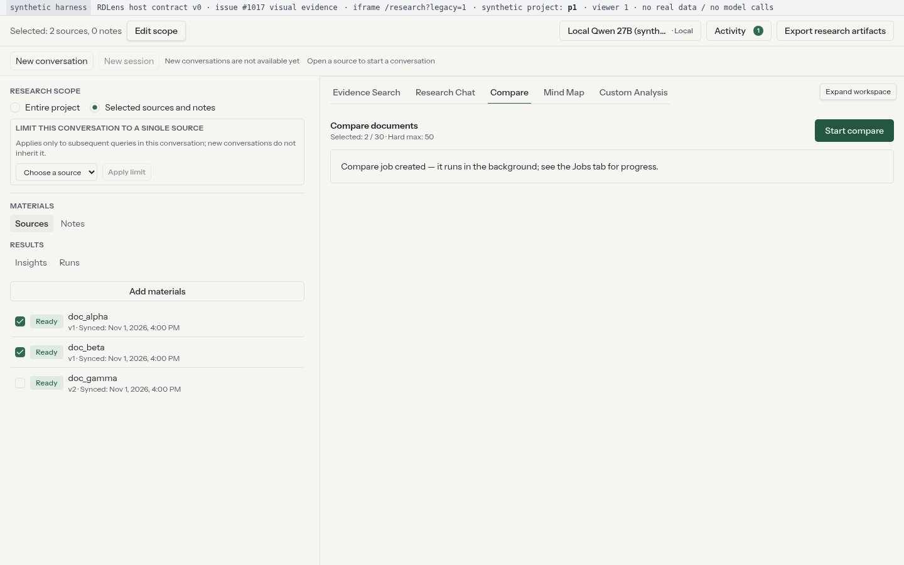 |

两侧 wire 相同：`X-Research-Contract: v1`、`document_ids:["doc_alpha","doc_beta"]`、
无 `source_scope`/`note_ids`。

### 2) 能力 true：C05 声明范围派发

**BEFORE / AFTER（`cap_on_all`，1440）**

| BEFORE | AFTER |
|---|---|
| 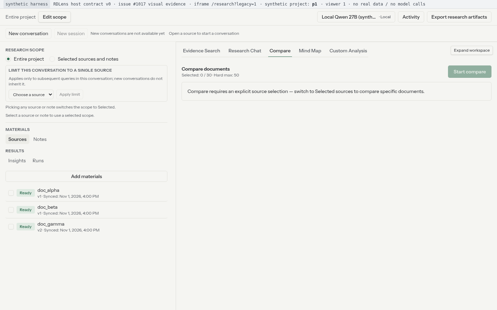 | 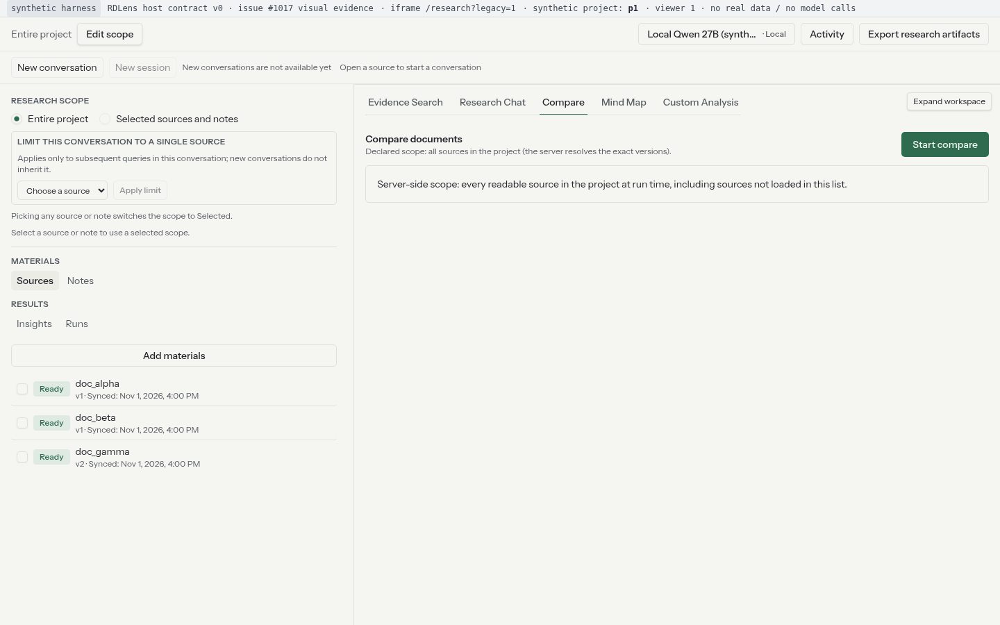 |

AFTER 额外提交态截图（`after_cap_on_all_submitted_1440.png`，
[1024 版](screenshots/after/after_cap_on_all_submitted_1024.png)）：

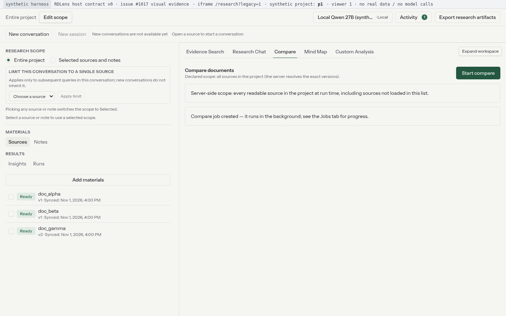

**BEFORE / AFTER（`cap_on_selected`，1440）**

| BEFORE | AFTER |
|---|---|
|  |  |

提交态 UI 视觉相同（两侧均显示 "Compare job created"）；差别只在 wire：
BEFORE `v1`+`document_ids` ↔ AFTER `c05-v1`+`source_scope.source_ids`（见 §wire 断言）。
1440 截图两侧逐字节相同（sha256 `9ec6b6e1…`）；1024 仅 5 px 抗锯齿差异
（`0a5ce576…` → `ad11583b…`，内容一致），UI 内容/布局无回归。

### 3) 结果回访：范围/覆盖/实际模型/校验状态

| 场景 | BEFORE（仅正文，无法区分校验状态） | AFTER（新增只读分区 + 显式状态） |
|---|---|---|
| pass |  | 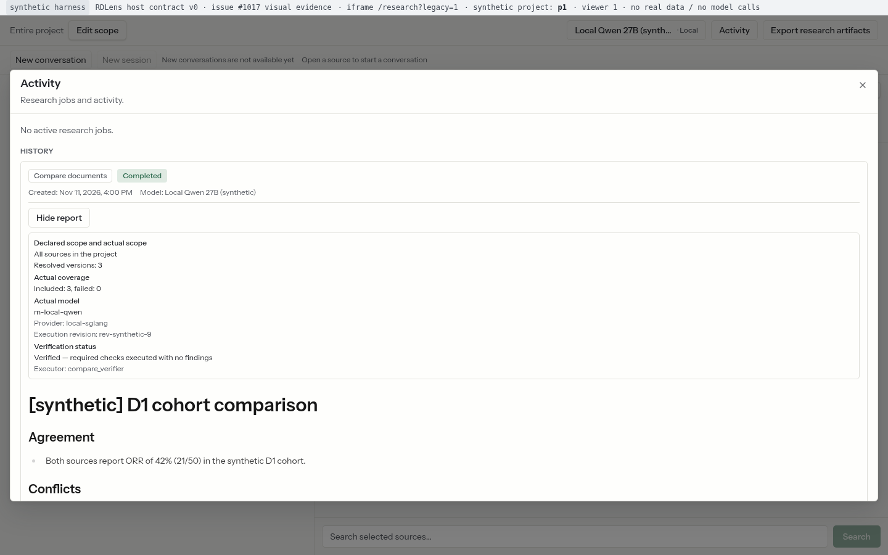 |
| degraded |  | 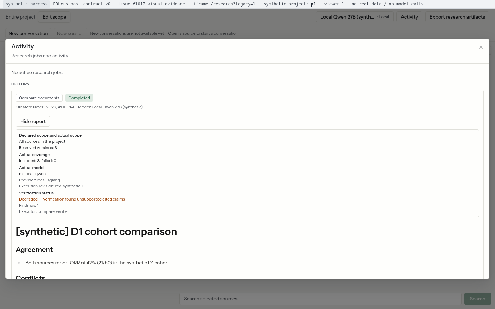 |
| partial | 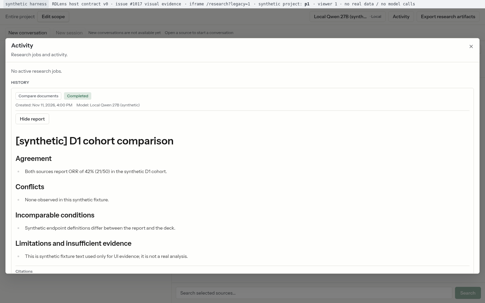 | 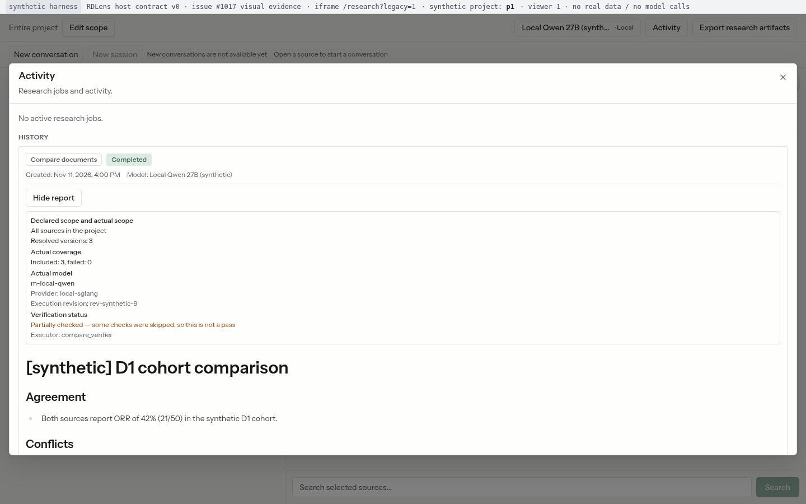 |
| not_run（旧 Job） |  | 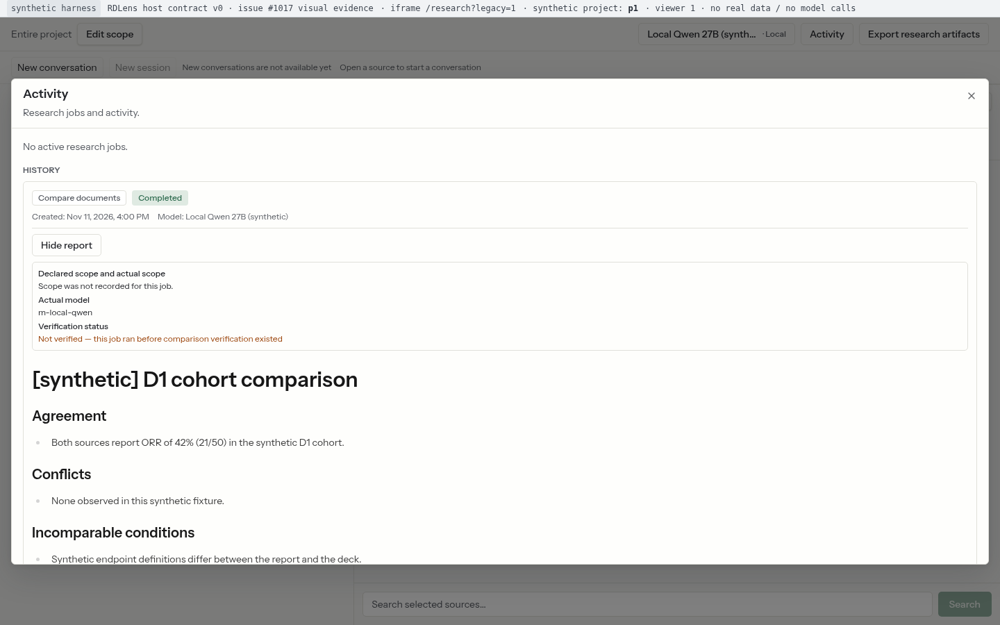 |

AFTER 分区内容（pass 场景，`requested_mode=selected`）：`Declared scope and actual
scope`（Selected sources / **Declared sources: 3** / Resolved versions: 3）、
`Actual coverage`（Included: 3, failed: 0）、`Actual model`（m-local-qwen /
Provider: local-sglang / Execution revision: rev-synthetic-9）、`Verification status`
（Verified — required checks executed with no findings / Executor: compare_verifier）。

### 4) report 端点终态：410 受限 / 503 可重试

**`report_410_revoked`**

| BEFORE（泛化错误） | AFTER（受限占位，无正文/引用） |
|---|---|
| 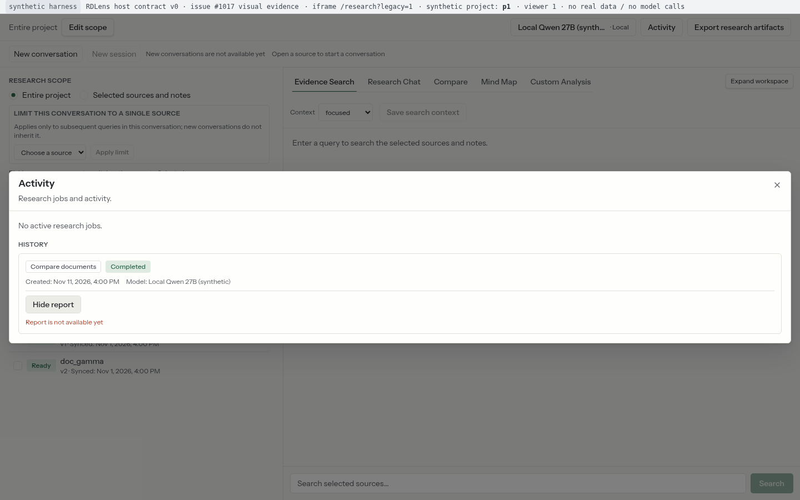 | 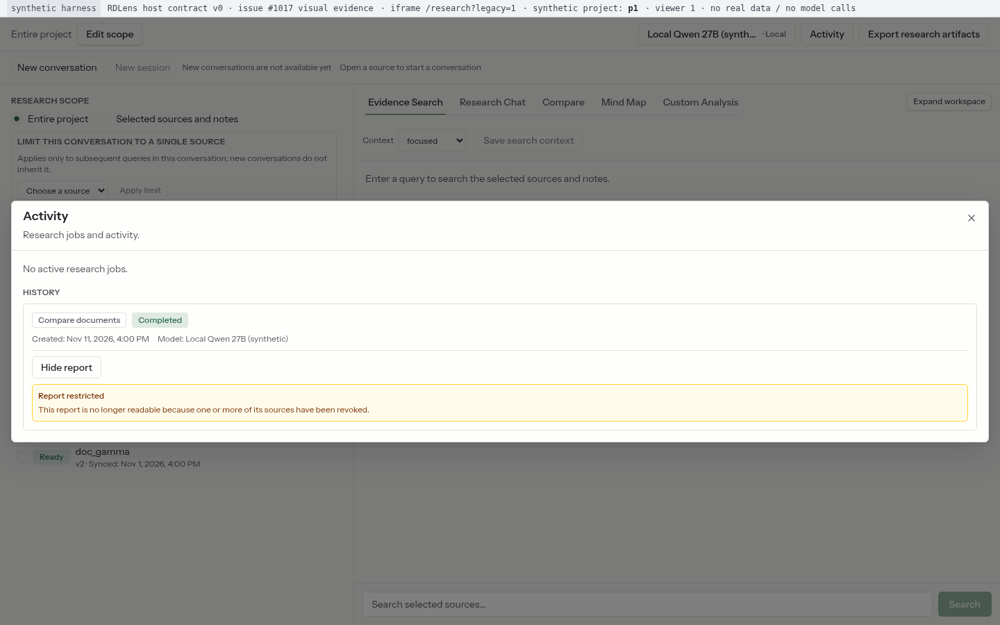 |

**`report_503`**

| BEFORE（泛化错误，无重试） | AFTER（可重试） |
|---|---|
|  | 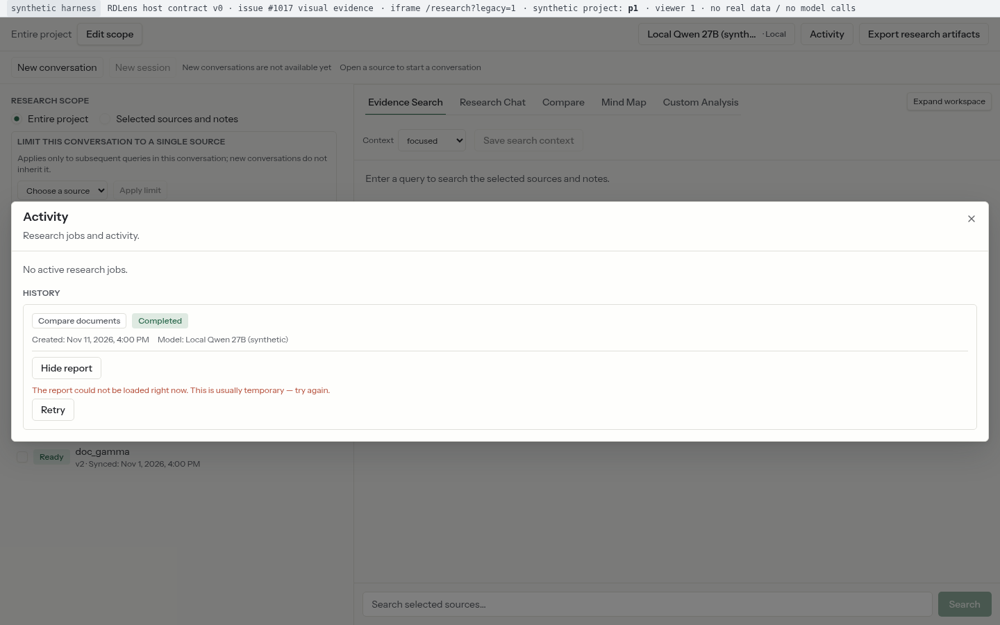 |

AFTER 重试成功截图（点击 `Retry`，服务端恢复后正文 + 校验分区渲染，
`report_requests=2`）：
[1440](screenshots/after/after_report_503_retried_1440.png) /
[1024](screenshots/after/after_report_503_retried_1024.png)。

1024×768 全部场景截图：`screenshots/{before,after}/*_1024.png`（20+24 张，sha256 见
`screenshots.sha256`）。

## Wire 级断言（真实请求头/body，取自 `capture.log`）

Gateway mock 捕获 `POST /v1/research/projects/p1/compare/jobs` 的原始请求：

| 阶段 | 场景 | `X-Research-Contract` | body（关键字段） |
|---|---|---|---|
| BEFORE | `cap_off_selected` | `v1` | `document_ids:["doc_alpha","doc_beta"]`；无 `source_scope`/`note_ids` |
| BEFORE | `cap_on_selected` | `v1` | 同上（能力位不被消费） |
| BEFORE | `cap_on_all` | —（无请求） | 能力 true 仍阻断 |
| AFTER | `cap_on_all` | `c05-v1` | `source_scope:{mode:"all",source_ids:[],single_source_id:null}`、`note_ids:[]`、无 `document_ids` |
| AFTER | `cap_on_selected` | `c05-v1` | `source_scope:{mode:"selected",source_ids:["src_alpha","src_beta"],single_source_id:null}`、`note_ids:[]`、无 `document_ids` |
| AFTER | `cap_off_all` | —（无请求） | 能力 false 保持阻断 |
| AFTER | `cap_off_selected` | `v1` | `document_ids:["doc_alpha","doc_beta"]`（legacy 逐字段不变） |

原始断言行（`capture.log`，节选）：

```text
after cap_on_all ASSERT PASS c05_header expected="c05-v1" actual="c05-v1"
after cap_on_all ASSERT PASS c05_source_scope_all expected={"mode":"all","source_ids":[],"single_source_id":null} actual={...}
after cap_on_all ASSERT PASS c05_note_ids_empty expected=[] actual=[]
after cap_on_all ASSERT PASS c05_no_document_ids expected=true actual=false
after cap_on_selected ASSERT PASS c05_source_scope_selected expected={"mode":"selected","source_ids":["src_alpha","src_beta"],"single_source_id":null} actual={...}
before cap_off_selected ASSERT PASS legacy_header_v1 expected="v1" actual="v1"
before cap_off_selected ASSERT PASS legacy_body_document_ids expected=["doc_alpha","doc_beta"] actual=["doc_alpha","doc_beta"]
after cap_off_selected ASSERT PASS legacy_body_no_source_scope expected=true actual=false
```

## 浏览器行为断言汇总

| 阶段 | 断言计数 | 说明 |
|---|---|---|
| BEFORE | 64 PASS / 0 FAIL / 0 scene errors | 10 scenes × 2 视口；覆盖 legacy 阻断/映射、报告正文可读、410/503 泛化错误 |
| AFTER | 130 PASS / 0 FAIL / 0 scene errors | 10 scenes × 2 视口（另 4 张补充运行截图：submitted×2、retried×2）；覆盖 C05 派发 wire、readback 分区（含声明来源数）、状态文案、受限占位、可重试与重试成功 |

关键断言（原样取自 `capture.log`）：

```text
before cap_on_all  ASSERT PASS all_still_blocked_before expected=">0" actual=1
before cap_on_all  ASSERT PASS no_create_request_before expected=0 actual=0
before report_pass ASSERT PASS before_no_readback_section expected=0 actual=0
before report_410_revoked ASSERT PASS before_generic_error_shown expected=true actual=true
before report_503 ASSERT PASS before_no_retry_button expected=0 actual=0
after cap_on_all  ASSERT PASS all_not_blocked_after expected=0 actual=0
after cap_on_all  ASSERT PASS declared_scope_notice expected=">0" actual=1
after report_pass ASSERT PASS after_declared_sources expected=">0" actual=1
after report_pass ASSERT PASS after_coverage_counts expected="counts>0 & unavailable=0" actual={"counts":1,"unavailable":0}
after report_pass ASSERT PASS after_verification_status expected="pass" actual="pass"
after report_degraded ASSERT PASS after_not_rendered_as_pass expected="no pass text" actual="Degraded — verification found unsupported cited claims"
after report_partial ASSERT PASS after_not_rendered_as_pass expected="no pass text" actual="Partially checked — some checks were skipped, so this is not a pass"
after report_not_run ASSERT PASS after_not_rendered_as_pass expected="no pass text" actual="Not verified — this job ran before comparison verification existed"
after report_410_revoked ASSERT PASS after_restricted_placeholder expected=">0" actual=1
after report_410_revoked ASSERT PASS after_no_report_body expected=0 actual=0
after report_503 ASSERT PASS after_retryable_shown expected=">0" actual=1
after report_503 ASSERT PASS after_retry_renders_report expected=">0" actual=1
```

## 复现性（两侧 UI 等价性，实测值）

- **逐字节相同**（sha256 完全相同）：`cap_off_selected` 1024（`ad11583b…`）、
  `cap_off_selected` 1440 与 `cap_on_selected` 1440（均为 `9ec6b6e1…`）。
- **仅抗锯齿差异**（内容/布局一致，diff 为 1–3 px 文字条带）：
  - `cap_off_all` 1024：`85aa78a6…` → `77077ff5…`，**32 px**（bbox y=33–36，标题文字
    抗锯齿条带）；
  - `cap_off_all` 1440：`ffed87ae…` → `5a77c31b…`，**45 px**（同一条带）；
  - `cap_on_selected` 1024：`0a5ce576…` → `ad11583b…`，**5 px**（bbox
    (338,318)-(340,322)，提交态提示文案抗锯齿）。
- 测量方法：对 `screenshots/{before,after}/` 当前提交文件做
  `PIL.ImageChops.difference` 后统计非零 RGB 像素数（bbox 同时记录）；可复跑
  `harness/capture.js` 后按同名文件复算。
- 结论：能力 false 与「仅 wire 变化」场景的 **UI 内容/布局无回归**；像素差仅来自字体
  抗锯齿/1–3 px 条带；wire 字段与浏览器行为断言逐项相同（见 §wire 断言与 §浏览器行为
  断言）。早期草稿的「三张全部逐字节相同」表述已按重采后的实测值更正（审查 MEDIUM-3）。
## 本地命令结果（真实输出，详见 `local-verification.txt`）

| 命令 | BEFORE（d959635） | AFTER（d80e074） |
|---|---|---|
| `npx vitest run <计划 §5.2 选定文件>` | 7 files / 168 tests passed | **8 files / 204 tests passed**, exit 0（新增 `CompareReportView.test.tsx` 1 文件 + 36 用例） |
| `npm run test`（全量，含 14 locale parity/unused-key） | 59 failed / 3305 passed（197 files；预先存在的 `src/app/research/*` 5 文件 + `SourceListPanel` 失败） | 59 failed / **3341 passed**（198 files；**失败集合/数量与基线逐项相同**，无新增失败；通过数 +36 = 新增 1 文件 36 用例） |
| `npm run lint` | 66 problems（5 errors / 61 warnings，均为预先存在） | 66 problems（5 errors / 61 warnings，**与基线逐项相同**；改动文件 0 新增告警） |
| `npx tsc -b` | — | exit 0 |
| `npm run build`（Next 生产构建） | — | exit 0 |

说明：fork 仓库无 CI；以上为本地真实命令输出。全量 vitest 与 lint 在基线上即非绿色
（`src/app/research/*` 5 个文件 59 个失败与 5 个第三方/既有 lint error），本 PR 的验收
以「改动文件/新增测试全绿 + 全量失败集合与基线逐项相同」为诚实口径，不宣称全量绿色。

## 限制与 NOT RUN

- **真实 host + PostgreSQL + 真实模型 + 真实 Research Gateway 的全栈走查：NOT RUN**。
  本环境无可用 RDLens host/PG/模型栈；证据为「真实 fork 应用 + mock Gateway」的合成
  harness（issue #1017 交付要求允许缺失即记 limited/NOT RUN，不伪造真实入口证据）。
- **真实外部模型调用/外发**：NOT RUN（B5/B6/#296/#1005 阻塞；无授权不外发）。
- **report 410 `compare_report_sources_unverifiable` 独立视觉截图**：未单独采集
  （`revoked` 已采集；unverifiable 的文案/占位行为由 `CompareReportView.test.tsx` 覆盖）。
- **#546 后台 poller 心跳故障回归**：NOT RUN（#546 OPEN；fork 侧不涉及）。
- **#304 生产 202→执行→结果证据归档**：NOT RUN（归 W4/#1180）。
- **#1018 旧 compare_result 专属回访 UI**：不在本单（#1193 host-only；本单只消费
  410/503 读面）。
- 合成 harness 覆盖 `capabilities` 与 job/report fixtures 的两档能力/六种报告终态；
  不覆盖真实服务端 C05 解析、真实校验记录生成（host PR 的合同节点负责）。

## 文件清单

```text
dev_docs/validation/issue1017/
  README.md                     ← 本文件
  capture.log                   ← BEFORE + AFTER 原始捕获日志（断言/计数/截图 DOM 计数）
  capture-before.log            ← BEFORE 原始日志
  capture-after.log             ← AFTER 原始日志
  before-manifest.json          ← BEFORE 场景/断言/截图/gateway 计数清单
  after-manifest.json           ← AFTER 场景/断言/截图/gateway 计数清单
  local-verification.txt        ← AFTER 本地命令真实输出（vitest/lint/tsc/build + 基线对照）
  screenshots.sha256            ← 44 张截图 sha256
  screenshots/before/           ← 20 张（10 scenes × 2 视口）
  screenshots/after/            ← 24 张（20 + submitted×2 + retried×2）
  harness/host_server.js        ← 合成宿主页（research-v0 握手）
  harness/gateway_mock.js       ← 路由 mock Gateway（能力/报告终态/请求捕获）
  harness/capture.js            ← 场景驱动 + 断言 + 截图/manifest
  harness/run_side.sh           ← 单侧运行（patch config → 起服务 → 捕获 → 还原）
  harness/run_all.sh            ← BEFORE + AFTER 串行复跑
  logs/                         ← 两侧 dev/gateway/host 日志 + config.ts sha256
```

复跑：

```bash
cd dev_docs/validation/issue1017/harness
WT_BEFORE=/path/to/fork-d959635 \
WT_AFTER=/path/to/fork-implementation-head \
AFTER_SHA=<impl-head-sha> ./run_all.sh
```
